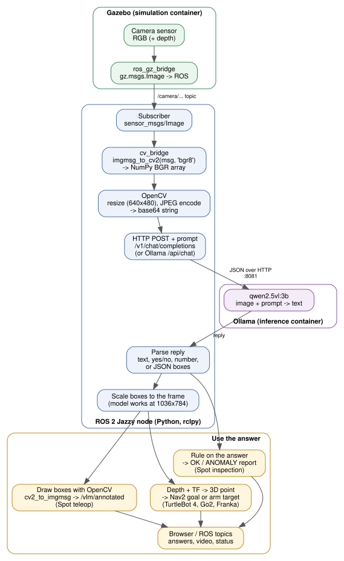

# VLM robotics workshop (Packt)

Five ROS 2 Jazzy + Gazebo Harmonic projects that put vision-language models on
robots. Each folder is self-contained, with its own Docker setup and a detailed
README. This page tells you how to run each one on its own.

| Project | Robot | What it does | VLM |
|---|---|---|---|
| [turtlebot4_vla_object_finder](turtlebot4_vla_object_finder/) | TurtleBot 4 | Finds an object named in a text instruction and drives to it with Nav2 | Qwen2.5-VL-3B |
| [unitree_go2_vlm_navigation](unitree_go2_vlm_navigation/) | Unitree Go2 | Quadruped that patrols a warehouse, marks the objects it sees as map waypoints, and walks to one when asked | Qwen2.5-VL-3B |
| [franka_vlm_pick_place](franka_vlm_pick_place/) | Franka Panda | Understands a tabletop scene and does pick and place from a text instruction | Qwen2.5-VL-3B |
| [spot_vlm_industrial_inspection](spot_vlm_industrial_inspection/) | Boston Dynamics Spot | Walks an inspection route and flags faults (gauges, leaks, open cabinet...) | Qwen2.5-VL-3B |
| [spot_vlm_teleop](spot_vlm_teleop/) | Boston Dynamics Spot | Starter: drive Spot from a web page, stream its camera, ask questions and draw labelled boxes (cv_bridge + Ollama API) | Qwen2.5-VL-3B |


## How every project gets from a camera image to a VLM answer



All five projects share this path. A Gazebo camera is bridged to a ROS 2
`sensor_msgs/Image` topic; a Python node converts it with **cv_bridge** to an
OpenCV BGR array, resizes it, encodes it as JPEG and base64, and posts it with a
prompt to **Ollama** serving `qwen2.5vl:3b` on port 8081. The reply is plain text,
a yes/no or a number, or JSON boxes; boxes come back in the model's own image
size (1036x784 for a 640x480 frame) and are scaled to the camera frame. What
happens next differs per project: draw the boxes (Spot teleop), turn them into a
3D goal with depth and TF (TurtleBot 4, Go2, Franka), or apply a rule and write a
report (Spot inspection). Spot inspection converts the image with NumPy instead
of cv_bridge; the result is the same BGR array.

The core of it, from [`spot_vlm_teleop`](spot_vlm_teleop/src/spot_vlm_teleop/spot_vlm_teleop/vlm.py):

```python
frame = CvBridge().imgmsg_to_cv2(msg, 'bgr8')                 # ROS Image -> OpenCV
ok, jpeg = cv2.imencode('.jpg', cv2.resize(frame, (640, 480)))
body = {'model': 'vlm', 'stream': False, 'options': {'temperature': 0},
        'messages': [{'role': 'user', 'content': 'What is in front of you?',
                      'images': [base64.b64encode(jpeg).decode()]}]}
answer = json.loads(urllib.request.urlopen(urllib.request.Request(
    'http://127.0.0.1:8081/api/chat', json.dumps(body).encode(),
    {'Content-Type': 'application/json'}), timeout=120).read())['message']['content']
```

The other projects send the same image and prompt to Ollama's OpenAI-compatible
`/v1/chat/completions` endpoint instead. Diagram source: [`docs/vlm_pipeline.dot`](docs/vlm_pipeline.dot).

## Before you start (all projects)

- Ubuntu 24.04, Docker Engine and Docker Compose v2 (`docker compose version`).
- Disk space, measured: each project needs about 16.5-19 GB (its ROS image plus the
  shared Ollama image, 8.4 GB, and `qwen2.5vl:3b` model, 3.2 GB, both stored once).
  All five together use about 32 GB, because the Ollama image, the model and the
  `ros:jazzy-ros-base` layers are shared and Spot teleop builds on the Spot image.
  Keep about 40 GB free for building all five (Docker build cache);
  `docker builder prune` reclaims the cache afterwards. Internet for the first build.

  | Project | Its own image | With shared Ollama image + model |
  |---|---|---|
  | TurtleBot 4 | 5.8 GB | about 17.5 GB |
  | Unitree Go2 | 7.2 GB | about 19 GB |
  | Franka Panda | 4.9 GB | about 16.5 GB |
  | Spot inspection | 5.2 GB | about 17 GB |
  | Spot teleop | +34 MB on the Spot inspection image | about 17 GB (34 MB if Spot inspection is built) |
- For a Gazebo window: a local X11 desktop session (`DISPLAY` and `XAUTHORITY` set).
- For GPU mode: an NVIDIA driver (`nvidia-smi` works) and
  [NVIDIA Container Toolkit](https://docs.nvidia.com/datacenter/cloud-native/container-toolkit/latest/install-guide.html).
  CPU mode works everywhere but each VLM answer takes 45–60 s instead of about 1 s.

Clone the repo into your home folder (the commands below assume
`~/vlm_packt_workshop`) and install Docker, Compose v2 and the NVIDIA Container
Toolkit with one script:

```bash
git clone https://github.com/runtimerobotics/vlm_packt_workshop.git ~/vlm_packt_workshop
cd ~/vlm_packt_workshop
bash scripts/install_prereqs.sh         # GPU (default; needs a working NVIDIA driver)
bash scripts/install_prereqs.sh cpu     # or: no NVIDIA GPU, skips the toolkit
```

The script asks for your sudo password, skips anything already installed, and
finishes by running a test container (and `nvidia-smi` inside one in GPU mode). If
it added you to the `docker` group, log out and back in before continuing. For
GPU mode without a driver, run `sudo ubuntu-drivers install`, reboot, then rerun
the script.

No ROS or Gazebo installation is needed on the host. Every project runs the
model, `qwen2.5vl:3b` (about 3.2 GB), in the official Ollama container. The first
start downloads it into the Docker volume `vlm-workshop-ollama`, which all
projects share, so it is downloaded only once.

## Run one project at a time

The projects use host networking and share fixed ports, so **stop one before
starting another**:

| Project | Web UI | VLM server | ROS domain | Stop command |
|---|---|---|---|---|
| TurtleBot 4 | 8000 | 8081 | 77 | `bash scripts/workshop.sh stop` |
| Unitree Go2 | 8000 | 8081 | 89 | `bash scripts/go2_sim.sh stop` |
| Franka Panda | 8000 | 8081 | 78 | `bash scripts/workshop.sh stop` |
| Spot | – | 8081 | 91 | `bash scripts/spot.sh stop` |
| Spot web teleop | 8000 | 8081 | 92 | `bash scripts/teleop.sh stop` |

To see what is running and what holds the ports:

```bash
docker ps --format '{{.Names}}  {{.Status}}'
ss -ltnp | grep -E ':8000|:8081'
```

"couldn't bind HTTP server socket ... port: 8081" or a page that never becomes
ready almost always means another project is still running.

---

## 1. TurtleBot 4 — VLM object finder

A browser instruction such as `go to the standing person` goes to a ROS 2 action
server. The robot looks around with Qwen2.5-VL, locates the object with depth and
TF on the warehouse map, and Nav2 drives to it.

**First-time setup** (downloads the model, builds the ROS and inference images):

```bash
cd ~/vlm_packt_workshop/turtlebot4_vla_object_finder
bash scripts/workshop.sh setup gpu      # or without an NVIDIA GPU: setup cpu
```

**Start:**

```bash
bash scripts/workshop.sh start gpu      # or: start cpu
```

**Use:** open http://127.0.0.1:8000 and wait for the status to be ready, idle and
stationary (`curl -fsS http://127.0.0.1:8000/status` shows `reasons` while it
initialises). Then try:

1. `go to the standing person` and wait for the navigation result.
2. `home` to return to the spawn pose (-3, -1).
3. Cancel stops an active request.

The home view has a red chair, cardboard box, standing person and blue barrel.
A green crate, orange cone and yellow box elsewhere in the warehouse exercise the
search behaviour.

**Optional Gazebo window** (second terminal, simulation must be running):

```bash
bash scripts/open_sim_gui.sh
```

**Check it end to end** (moves the robot):

```bash
python3 scripts/verify_demo.py --mode simulation --prompt 'go to the standing person'
```

**Logs and stop:**

```bash
docker compose --profile simulation logs -f --tail 50 application inference
bash scripts/workshop.sh stop
```

After changing code, launch, world or config files, run `stop`, `setup` and
`start` again: the images contain copied files. A no-model mock mode, memory
measurement and running against an external robot are in the
[project README](turtlebot4_vla_object_finder/README.md).

---

## 2. Unitree Go2 — VLM patrol, object waypoints, SLAM and Nav2

The Go2 with the CHAMP gait in Gazebo, with keyboard/rqt teleoperation and
warehouse Nav2/SLAM, plus a VLM patrol: the Go2 walks a Nav2 route, Qwen2.5-VL-3B
names the objects in its D455 depth camera and marks each as a map waypoint, and
"go to the green dumpster" sends it straight to that waypoint.

**Build** (first time; compiles the upstream workspace, takes a while):

```bash
cd ~/vlm_packt_workshop/unitree_go2_vlm_navigation
bash scripts/go2_sim.sh build cpu
```

**Start a world** (a Gazebo window opens):

```bash
bash scripts/go2_sim.sh start cpu              # default simple world
bash scripts/go2_sim.sh start cpu industrial   # electrical substation
bash scripts/go2_sim.sh start cpu warehouse    # AWS small warehouse
```

Use `gpu` instead of `cpu` to render on the NVIDIA GPU and enable the D455 depth
camera and 3D lidars. CPU mode keeps only the RGB camera.

**Drive it** (separate terminal):

```bash
bash scripts/go2_control.sh keyboard   # u/i/o, j/k/l, m/,/. ; Ctrl+C exits
bash scripts/go2_control.sh rqt        # slider GUI
bash scripts/go2_sim.sh rviz           # RViz with the robot and camera
```

**Warehouse navigation or mapping:** start the warehouse with the Velodyne on and
the fixed map transform off, then start Nav2 or SLAM:

```bash
GO2_PUBLISH_MAP_TO_ODOM=false bash scripts/go2_sim.sh start gpu warehouse
# or CPU: GO2_PUBLISH_MAP_TO_ODOM=false GO2_DISABLE_VELODYNE=false bash scripts/go2_sim.sh start cpu warehouse

bash scripts/start_nav2.sh nav2         # AMCL on the generated map
bash scripts/start_nav2.sh slam         # online slam_toolbox + Nav2
bash scripts/start_nav2.sh nav2 true    # same, with RViz
bash scripts/stop_nav2.sh               # stop Nav2/SLAM, keep Gazebo
```

**VLM object finding** (warehouse, needs the D455: GPU mode, or CPU mode with
`GO2_DISABLE_D455=false` added to the start command). With the warehouse and
`start_nav2.sh nav2` running, in a third terminal:

```bash
bash scripts/start_vlm.sh gpu   # or cpu; Ollama on 8081, web UI on 8000
```

Open <http://127.0.0.1:8000> and send `patrol`: the Go2 walks a Nav2 route,
Qwen2.5-VL labels what it sees, and each object is stored as a map waypoint (listed
in the page and shown as RViz markers on `/vlm_nav/objects`). Then send e.g.
`go to the green dumpster` and it walks to that waypoint; objects never seen on
patrol fall back to a live search, and absent objects are refused. The model
comes from the shared `vlm-workshop-ollama` volume; the first start downloads it.

**Logs and stop:**

```bash
bash scripts/go2_sim.sh logs
bash scripts/go2_sim.sh status
bash scripts/go2_sim.sh stop
```

If the Gazebo window does not open and your desktop uses a non-default X auth
file, run `export XAUTHORITY=/run/user/1000/gdm/Xauthority` first. More detail,
including the idle-container workflow, is in the
[project README](unitree_go2_vlm_navigation/README.md).

---

## 3. Franka Panda — VLM pick and place

Type an instruction such as `put the red cube on the yellow tray`. The VLM lists
the objects on the table, extracts what to pick and where to put it, and boxes
both in an overhead RGB-D camera. Depth turns the boxes into 3D points, and the
Panda does a top-down pick and place.

**First-time setup** (downloads the model, builds the ROS and inference images):

```bash
cd ~/vlm_packt_workshop/franka_vlm_pick_place
bash scripts/workshop.sh setup gpu      # or without an NVIDIA GPU: setup cpu
```

**Start:**

```bash
bash scripts/workshop.sh start gpu      # or: start cpu
```

**Use:** open http://127.0.0.1:8000 and wait for **Ready** (about 30 s after the
VLM is up). The scene has red, green and blue cubes and yellow and purple trays.
Try:

- `put the red cube on the yellow tray`
- `move the blue block onto the purple tray`
- `the green cube belongs on the yellow tray` (placing on a tray that already
  holds a cube stacks on top of it)
- `put the orange ball in the bin`, which should be refused because there is no orange object

The page shows the live camera, the VLM's scene list and plan, the last detection
boxes (pick in yellow, place in magenta) and a log. With the GPU each task takes
about 20 s.

**Optional Gazebo window** (second terminal, simulation must be running):

```bash
bash scripts/workshop.sh gui
```

**Logs, tests and stop:**

```bash
bash scripts/workshop.sh logs
python3 -m pytest -q tests              # kinematics, reachability, projection, VLM parsing
bash scripts/workshop.sh stop
```

To reset the cubes to their start positions, run `stop` then `start`. After
changing code or the world, rebuild with `docker compose build simulation` (the
application uses the same image) before `start`. Limits and the pipeline are in
the [project README](franka_vlm_pick_place/README.md).

---

## 4. Spot — VLM industrial inspection

Spot walks six stations in a simulated plant. At each one it points its camera
at the asset and asks the VLM a concrete question (gauge reading, leak, missing
extinguisher, open cabinet, blocked exit). Findings go to `/inspection/report`
and to a Markdown report with images.

**Model:** `start` also runs Ollama with `qwen2.5vl:3b` from the shared
`vlm-workshop-ollama` volume; the first start downloads it (3.2 GB).

**Build, start and inspect:**

```bash
cd ~/vlm_packt_workshop/spot_vlm_industrial_inspection
bash scripts/spot.sh build      # first time: ROS/Gazebo image
bash scripts/spot.sh start      # Gazebo window opens, Spot spawns standing
bash scripts/spot.sh inspect    # walks S1..S6, asks the VLM, returns home
```

GPU is the default; add `cpu` (`start cpu`, `inspect cpu`) without an NVIDIA
GPU. `bash scripts/spot.sh teleop` drives Spot from the keyboard.

**Results:** each run writes `reports/<timestamp>/report.md`, `results.json` and
one image per station. Live findings:

```bash
docker compose -p spot-vlm-inspection exec simulation bash -lc \
  'source /spot_ws/install/setup.bash && ros2 topic echo /inspection/report'
```

**Logs and stop:**

```bash
bash scripts/spot.sh logs
bash scripts/spot.sh status
bash scripts/spot.sh stop
```

The route and per-station questions are in
`src/spot_inspection/config/route.yaml`; the world is generated by
`scripts/make_world.py`. See the [project README](spot_vlm_industrial_inspection/README.md).

---

## 5. Spot — web teleop and VLM questions (starter)

The simplest project and a good first one: drive Spot from a web page, watch its
camera, ask the VLM about the image, and see labelled boxes drawn with OpenCV.
One ROS 2 node shows the whole path from camera image through cv_bridge to the
Ollama chat API and back. It builds on the Spot inspection image above (built
automatically if missing).

```bash
cd ~/vlm_packt_workshop/spot_vlm_teleop
bash scripts/teleop.sh build    # first time
bash scripts/teleop.sh start    # Gazebo opens, Spot stands
# open http://127.0.0.1:8000: hold the arrows to drive, Ask a question, or Detect objects
bash scripts/teleop.sh stop
```

Add `cpu` without an NVIDIA GPU. See the [project README](spot_vlm_teleop/README.md).

---

## Switching between projects

```bash
# Stop whatever is running (run the one that applies)
cd ~/vlm_packt_workshop/turtlebot4_vla_object_finder && bash scripts/workshop.sh stop
cd ~/vlm_packt_workshop/franka_vlm_pick_place        && bash scripts/workshop.sh stop
cd ~/vlm_packt_workshop/spot_vlm_industrial_inspection && bash scripts/spot.sh stop
cd ~/vlm_packt_workshop/unitree_go2_vlm_navigation    && bash scripts/go2_sim.sh stop
cd ~/vlm_packt_workshop/spot_vlm_teleop               && bash scripts/teleop.sh stop

# Confirm nothing is left, then start the next project
docker ps
```

Stopping keeps built images and model files, so restarting a project does not
rebuild or download again.
