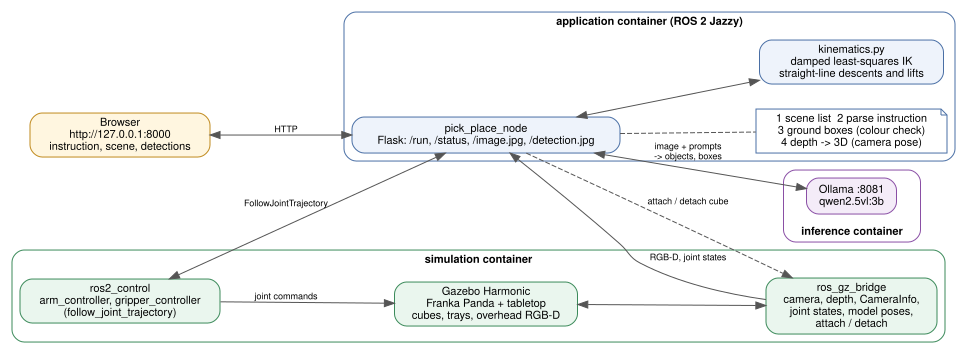
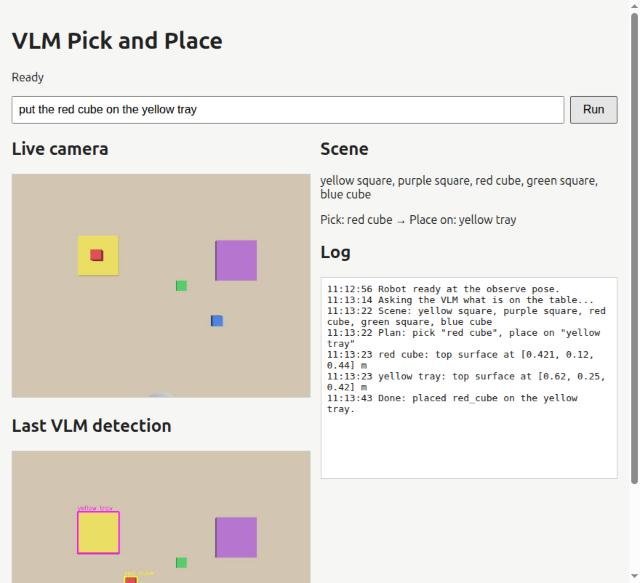

# Franka VLM pick and place — ROS 2 Jazzy + Gazebo

Type an instruction such as *"put the red cube on the yellow tray"* in a local
browser. A Franka Panda in Gazebo uses Qwen2.5-VL-3B (served by Ollama) to understand the
table scene, finds both objects in an overhead RGB-D camera, turns the boxes into
3D points with depth, and does a top-down pick and place.

Same stack as the TurtleBot 4 and Go2 workshops in this repo: Docker, ROS 2 Jazzy,
Gazebo Harmonic, and the same Ollama model service.

## Pipeline



1. **Scene understanding** — the VLM lists the objects on the table (shown in the UI).
2. **Instruction parsing** — the VLM extracts the object to pick and the destination.
3. **Grounding** — the VLM returns a 0..1000 box for each phrase. A box whose pixels
   do not have the colour the phrase names is rejected: small VLMs tend to box the
   nearest object instead of saying "not visible".
4. **3D** — the nearest coherent depth surface in each box is back-projected and
   transformed with the known camera pose (`description.py`, matching the world SDF).
5. **Motion** — damped least-squares IK on the URDF's own kinematics (no MoveIt);
   straight-line descents and lifts via `joint_trajectory_controller`.
6. **Grasp** — the fingers close, then a Gazebo `DetachableJoint` attaches the cube,
   but only if a cube is actually within 2.5 cm of the fingertips. Friction grasps in
   Gazebo are too flaky for a workshop. Placing on an occupied tray stacks on top,
   because the nearest surface in the tray's box is then the cube.

## Requirements

- Ubuntu 24.04 desktop (X11 for the optional Gazebo window) with Docker Engine
  and Compose v2.
- About 20 GB free disk and internet for the first build and the 3.2 GB model.
- GPU mode: NVIDIA driver + NVIDIA Container Toolkit. CPU mode works but each
  VLM answer takes 45–60 s instead of about 1 s.

Install Docker, Compose v2 and the NVIDIA Container Toolkit with
[`scripts/install_prereqs.sh`](../scripts/install_prereqs.sh) from the repo root.

## Tested environment

Verified on 2026-10-25 by running this project from this README in GPU mode.
Everything except the host rows runs inside Docker, so the host needs no ROS or Gazebo.

| Component | Version |
|---|---|
| Host OS | Ubuntu 24.04.4 LTS (kernel 7.0), X11 desktop session |
| Host hardware | Intel Core i7-13650HX, 23 GB RAM, NVIDIA GeForce RTX 4060 Laptop GPU (8 GB) |
| NVIDIA | Driver 580.178.04 (CUDA 13.0), NVIDIA Container Toolkit 1.19.1 |
| Docker | Docker Engine 29.6.2, Docker Compose v5.3.1 |
| Container OS | Ubuntu 24.04.5 LTS, `ros:jazzy-ros-base` image (`franka-vlm-ros:local`) |
| ROS 2 | Jazzy (rclpy 7.1.12), Fast DDS (`rmw_fastrtps_cpp`), `ROS_DOMAIN_ID` 78 |
| Gazebo | Harmonic (Gazebo Sim 8.15.0), ros_gz 1.0.24 |
| Robot and control | Franka Panda from `moveit_resources_panda_description` 3.1.0 (no MoveIt planning), ros2_control 4.48.1, gz_ros2_control 1.2.20 |
| Python | 3.12.3, OpenCV 4.6.0, NumPy 1.26.4, Flask 3.0.2, cv_bridge 4.1.0 |
| VLM server | Ollama 0.40.10 (`ollama/ollama:0.40.10` image), model `qwen2.5vl:3b` (3.2 GB), port 8081 |

## Run

```bash
cd ~/vlm_packt_workshop/franka_vlm_pick_place
bash scripts/workshop.sh setup gpu   # or: setup cpu  (builds the ROS image, downloads the 3.2 GB model once)
bash scripts/workshop.sh start gpu   # or: start cpu
```

Open http://127.0.0.1:8000, wait for **Ready**, then run an instruction such as
`put the red cube on the yellow tray`.



Measured in GPU mode (RTX 4060 Laptop GPU), one instruction after another from a
fresh start: red cube on the yellow tray, blue cube stacked on it, blue cube to the
purple tray, red cube to the purple tray (stacked), green cube on the yellow tray.
All five succeeded, 25-36 s each (about 8 s of that is VLM calls).
`bash scripts/workshop.sh gui` opens the Gazebo GUI (X11), `logs` follows output,
`stop` shuts everything down. Port 8081 (VLM) and 8000 (web) must be free: stop
the other workshops first. ROS domain defaults to 78.

## Scene

Red, green and blue 4 cm cubes; yellow and purple trays. Edit
`src/vlm_pick_place/worlds/tabletop.sdf`; cubes the robot can grasp must also be
listed in `GRASPABLE` in `description.py` (checked by `tests/test_scene.py`).

## Tests

```bash
python3 -m pytest -q tests   # kinematics, reachability, projection, VLM output parsing (rclpy tests need the ROS image)
```

## Known limits

- Cubes are grasped at yaw 0; rotated cubes are not handled.
- No collision checking; the motions assume an open tabletop.
- Colourless phrases ("the bin") are not colour-verified.
- The UI is unauthenticated and binds to 127.0.0.1 only.
