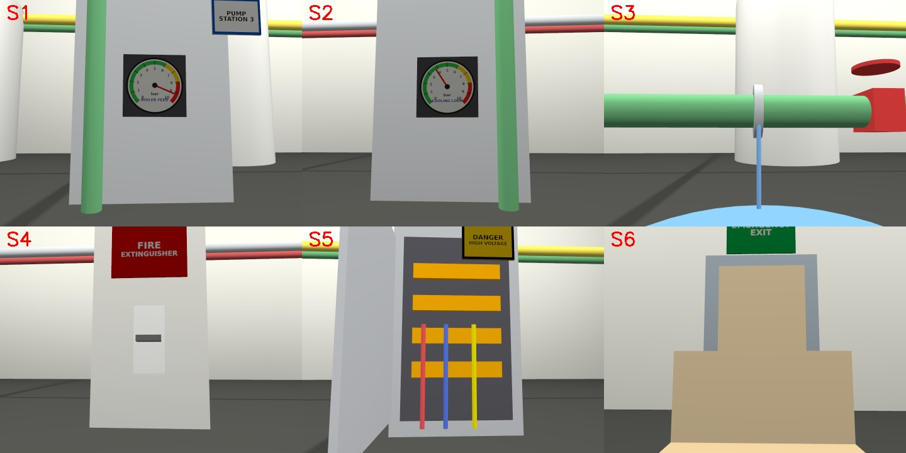
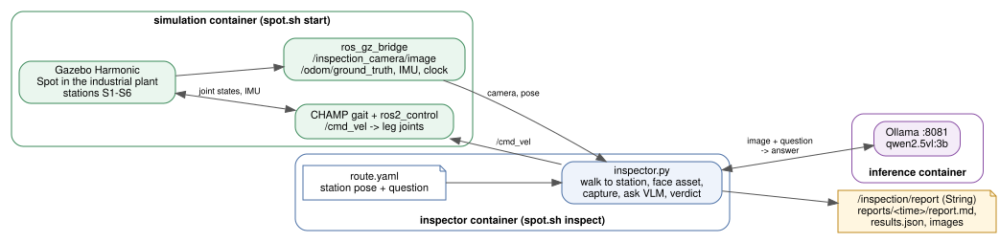

# VLM-based industrial inspection with Boston Dynamics Spot (Gazebo)

Spot walks an inspection route through a simulated industrial plant. At each
asset it stops, points its inspection camera at it, and asks a vision-language
model (Qwen2.5-VL-3B served by Ollama) a concrete question: is the gauge in the red,
is there a leak, is the extinguisher missing, is the cabinet open, is the exit
blocked. Findings are published on `/inspection/report` and written to a
Markdown report with the captured images.

Stack: ROS 2 Jazzy, Gazebo Harmonic, official Spot model, CHAMP gait controller,
Ollama (OpenAI-compatible API). Everything runs in Docker.

## Plant and route





| Station | Asset | Planted fault |
|---|---|---|
| S1 | Boiler feed pressure gauge | Needle at 9.2 bar, in the red zone |
| S2 | Cooling loop pressure gauge | None (3.8 bar, green) — control case |
| S3 | Pipe flange | Dripping leak and water puddle |
| S4 | Fire extinguisher point | Bracket empty, extinguisher missing |
| S5 | High-voltage electrical cabinet | Door left open, breakers exposed |
| S6 | Emergency exit | Blocked by a pallet of boxes |

The route and the question for each station live in
[`src/spot_inspection/config/route.yaml`](src/spot_inspection/config/route.yaml).
The world is generated by [`scripts/make_world.py`](scripts/make_world.py)
(gauge faces and signs are drawn there too); rerun it after editing.

## Requirements

- Ubuntu 24.04 desktop (X11) with Docker Engine and Compose v2.
- Internet on the first start: Ollama downloads `qwen2.5vl:3b` (3.2 GB) into the
  `vlm-workshop-ollama` volume shared with the other workshop projects.
- GPU mode (default): NVIDIA driver + NVIDIA Container Toolkit. CPU mode works
  but each VLM answer takes roughly a minute.

Install Docker, Compose v2 and the NVIDIA Container Toolkit with
[`scripts/install_prereqs.sh`](../scripts/install_prereqs.sh) from the repo root.

## Tested environment

Verified on 2026-10-25 by running this project from this README in GPU mode.
Everything except the host rows runs inside Docker, so the host needs no ROS or Gazebo.

| Component | Version |
|---|---|
| Host OS | Ubuntu 24.04.4 LTS (kernel 7.0), X11 desktop session |
| Host hardware | Intel Core i7-13650HX, 23 GB RAM, NVIDIA GeForce RTX 4060 Laptop GPU (8 GB) |
| NVIDIA | Driver 580.178.04 (CUDA 13.0), NVIDIA Container Toolkit 1.19.1 |
| Docker | Docker Engine 29.6.2, Docker Compose v5.3.1 |
| Container OS | Ubuntu 24.04.5 LTS, `ros:jazzy-ros-base` image (`spot-inspection-ros:local`) |
| ROS 2 | Jazzy (rclpy 7.1.12), Fast DDS (`rmw_fastrtps_cpp`), `ROS_DOMAIN_ID` 91 |
| Gazebo | Harmonic (Gazebo Sim 8.15.0), ros_gz 1.0.24 |
| Robot and control | Spot model and CHAMP gait (sources in [UPSTREAM.md](UPSTREAM.md)), ros2_control 4.48.1, gz_ros2_control 1.2.20, robot_localization 3.8.3 |
| Python | 3.12.3, OpenCV 4.6.0, NumPy 1.26.4, cv_bridge 4.1.0 |
| VLM server | Ollama 0.40.10 (`ollama/ollama:0.40.10` image), model `qwen2.5vl:3b` (3.2 GB), port 8081 |

## Run

```bash
cd spot_vlm_industrial_inspection
bash scripts/spot.sh build          # first time: ROS/Gazebo image
bash scripts/spot.sh start          # Gazebo window opens; Spot spawns standing
bash scripts/spot.sh inspect        # walks S1..S6, asks the VLM, returns home
bash scripts/spot.sh stop
```

Use `cpu` as the second argument (`start cpu`, `inspect cpu`) without an NVIDIA GPU.
`bash scripts/spot.sh teleop` drives Spot from the keyboard.

Each run writes `reports/<timestamp>/report.md`, `results.json` and one image
per station. Live results:

```bash
docker compose -p spot-vlm-inspection exec simulation bash -lc \
  'source /spot_ws/install/setup.bash && ros2 topic echo /inspection/report'
```

### Without Docker (host ROS 2 Jazzy)

```bash
colcon build --symlink-install --base-paths src upstream --cmake-args -DBUILD_TESTING=OFF
source install/setup.bash
ros2 launch spot_inspection_sim sim.launch.py
# second terminal, with an OpenAI-compatible VLM server (e.g. Ollama) on :8081
ros2 launch spot_inspection inspection.launch.py report_dir:=$PWD/reports
```

## How it works

- **Robot**: the official Spot URDF from RAI Institute (`spot_description`),
  wrapped in [`spot_gazebo.urdf.xacro`](src/spot_inspection_sim/urdf/spot_gazebo.urdf.xacro)
  with `gz_ros2_control`, an IMU, ground-truth odometry and a 960x720
  inspection camera on the front rail.
- **Walking**: CHAMP turns `/cmd_vel` into leg trajectories
  (`joint_group_position_controller`). Spot spawns in CHAMP's stance pose so
  it never has to stand up from a heap.
- **Navigation**: the inspector steers on Gazebo ground-truth odometry along
  the open main aisle (turn in place, then walk). This is a simulation
  shortcut; a real deployment would use a map, AMCL/SLAM and Nav2.
- **Perception**: after stopping, the inspector waits 2 s for the gait to
  settle, takes a fresh frame, and asks the station's short question
  (gauges: "which number does the needle point to?", others: a yes/no
  question). A rule in `route.yaml` turns the answer into OK/ANOMALY
  (`max_value: 6.0`, `anomaly_if: 'yes'`), so the verdict never depends on the
  model judging "is something wrong?" — which the 2B model answers "yes" to
  almost everything. A second call adds a one-sentence description for the
  report. An answer that fits no rule is reported as UNKNOWN.

## Results

On an RTX 4060 laptop (GPU mode) each VLM answer takes 1-3 s and a full route
takes about 4.5 minutes, mostly walking. With `qwen2.5vl:3b` on Ollama and the
questions in `route.yaml`, the latest run flagged all five faults and passed the
healthy S2 gauge (6/6, S1 read as 8 bar, S2 as 4 bar); that run is in
[docs/sample_report](docs/sample_report/report.md).

The S5 and S6 questions were reworded after a run in which the 3B model answered
"no" to "Is the electrical cabinet door open?" and "Are boxes blocking the door?"
although both faults were in full view (4/6). Checked live against the closed
control cabinet at x=17: "Is the cabinet door open so that the wiring inside is
visible?" answered no in 2 of 3 runs and yes on the open S5 cabinet every time;
"Can you see red, blue and yellow wires?" also fired on the closed cabinet (the
overhead pipes are coloured), so it was not used. The world also has a stocked
extinguisher at x=18.5 as a control for S4. There is no unblocked exit to test S6
against; the S6 question answered no on the S1-S4 frames.

## Limits

- Small VLMs are sensitive to wording and even JPEG re-encoding: the same S5
  question gave different answers on a frame and on its saved JPEG, and earlier
  phrasings missed the leak or the open cabinet on some runs. Expect an occasional
  false ANOMALY at S5. The
  faults are deliberately large and high-contrast, and the descriptions in the
  report can be wrong (e.g. "7 bar" for a 3.8 bar gauge) even when the
  verdict is right. Swap in a larger VLM by pointing
  `inference_url` at any OpenAI-compatible server.
- CHAMP is a kinematic gait, not Spot's real controller: walking is slower and
  less robust than the real robot, and rough terrain is out of scope.
- See [UPSTREAM.md](UPSTREAM.md) for sources, licenses and local patches.
