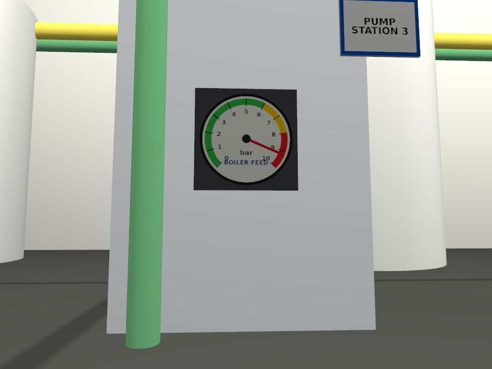
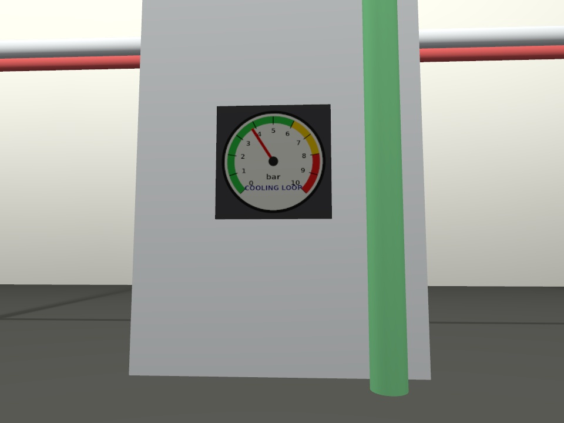
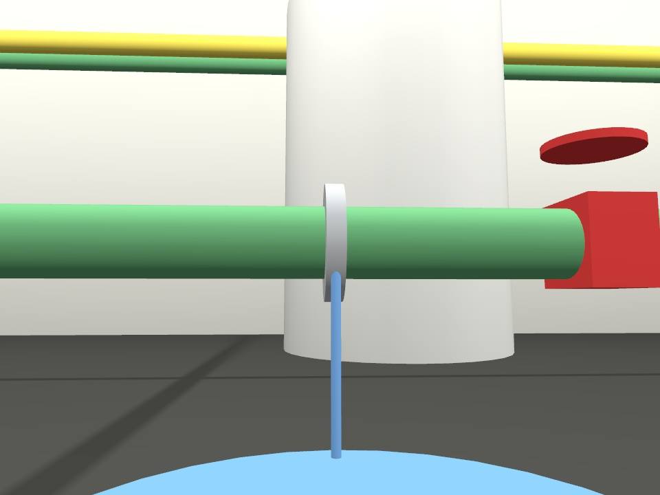
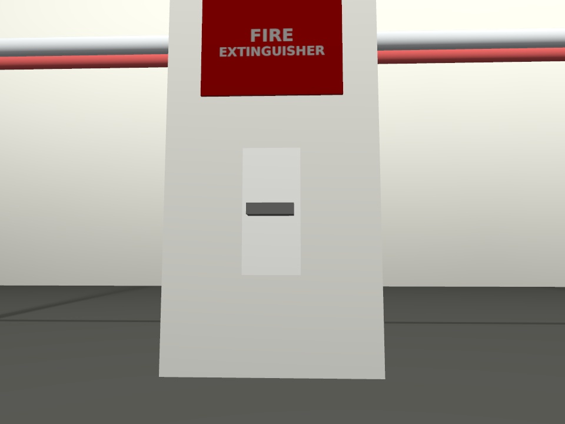
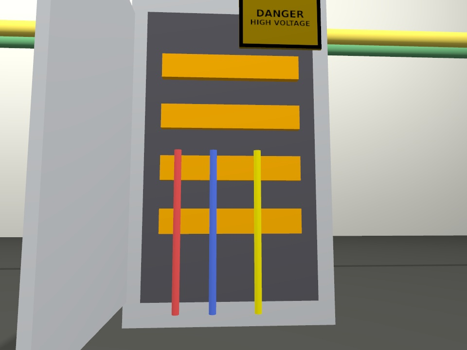
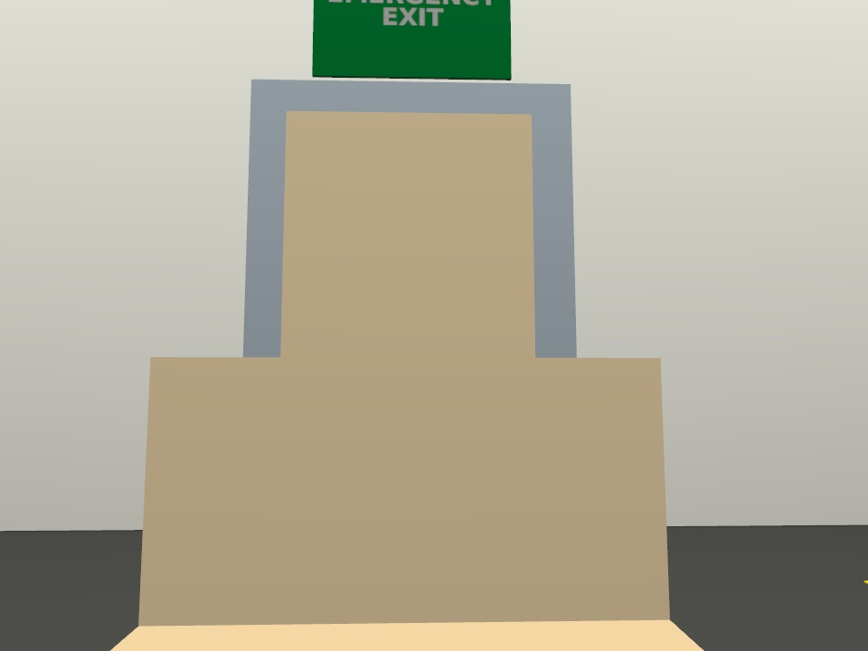

# Spot inspection report

Generated 2026-10-25 11:41

| Station | Status | VLM answer | VLM description |
|---|---|---|---|
| S1 boiler feed pressure gauge | **ANOMALY** | 8 | The image shows a pressure gauge with the needle pointing to 8 bar, indicating the pressure level in a system. |
| S2 cooling loop pressure gauge | OK | 4 | The image shows a pressure gauge with a needle pointing to 1 bar, indicating a cooling loop. |
| S3 pipe flange and floor | **ANOMALY** | Yes. | A green pipe with a blue liquid inside is connected to a red valve. |
| S4 fire extinguisher point | **ANOMALY** | No. | A fire extinguisher sign is displayed on a wall. |
| S5 electrical cabinet | **ANOMALY** | Yes. | The image shows a high-voltage warning sign with colored lines indicating different voltage levels. |
| S6 emergency exit | **ANOMALY** | Yes. | A green sign with the word "EXIT" is attached to a gray door. |

## S1 boiler feed pressure gauge

Q: Read the pressure gauge in bar. Reply with only the number the needle points to.  
A: `8` (2.6 s)

## S2 cooling loop pressure gauge

Q: Read the pressure gauge in bar. Reply with only the number the needle points to.  
A: `4` (2.5 s)

## S3 pipe flange and floor

Q: Is there a blue puddle on the floor? Answer yes or no.  
A: `Yes.` (1.3 s)

## S4 fire extinguisher point

Q: Is there a red cylinder below the sign? Answer yes or no.  
A: `No.` (1.3 s)

## S5 electrical cabinet

Q: Is the cabinet door open so that the wiring inside is visible? Answer yes or no.  
A: `Yes.` (1.4 s)

## S6 emergency exit

Q: Are there cardboard boxes in front of the exit door? Answer yes or no.  
A: `Yes.` (1.4 s)
