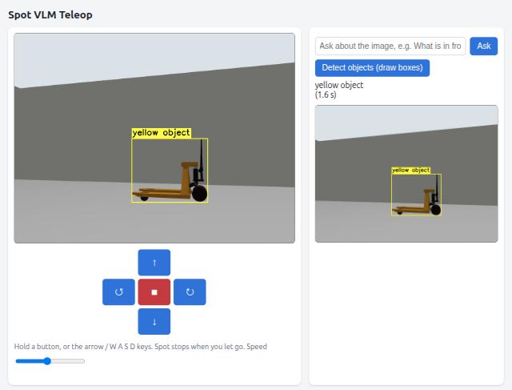

# Spot web teleop + VLM questions (starter project)

Drive Boston Dynamics Spot from a web page, watch its camera live, ask a
vision-language model about what it sees, and get labelled bounding boxes drawn
on the image. It is the smallest end-to-end example of **ROS 2 camera image →
cv_bridge → OpenCV → Ollama API → answer back into ROS and the browser**, and a
starting point for the other workshop projects.



Stack: ROS 2 Jazzy, Gazebo Harmonic, Spot with the CHAMP gait (from
[`../spot_vlm_industrial_inspection`](../spot_vlm_industrial_inspection/)),
Ollama serving `qwen2.5vl:3b`, Flask. Everything runs in Docker.

## What you can do

| On the page | What happens |
|---|---|
| Hold an arrow button, or arrow / W A S D keys | `geometry_msgs/Twist` on `/cmd_vel`; Spot walks or turns. Letting go stops it (0.5 s dead-man). |
| **Ask** a question | The current frame and your question go to Ollama; the answer is shown under the frame the model saw. |
| **Detect objects** | The model returns a label and box for each object; OpenCV draws them on the snapshot and, until Spot moves (max 10 s), on the live stream. |

The room has eight objects around Spot's start pose: a green dumpster ahead, a
red barrel and a blue crate ahead left and right, a desk and a bucket to the left,
a pallet jack to the right, and a shelf and a box stack behind.

## Run

Requirements, as for the other projects: Ubuntu 24.04 X11 desktop, Docker with
Compose v2, and for GPU mode the NVIDIA Container Toolkit
([`../scripts/install_prereqs.sh`](../scripts/install_prereqs.sh)). Stop any other
workshop project first: they share ports 8000 and 8081.

```bash
cd spot_vlm_teleop
bash scripts/teleop.sh build    # first time; also builds the Spot inspection image it uses
bash scripts/teleop.sh start    # Gazebo opens, Spot stands; Ollama loads the model
# open http://127.0.0.1:8000
bash scripts/teleop.sh stop
```

Add `cpu` (`build cpu`, `start cpu`) without an NVIDIA GPU; each answer then takes
about a minute instead of 1-2 s. The first start downloads `qwen2.5vl:3b`
(3.2 GB) into the `vlm-workshop-ollama` volume shared by all workshop projects,
unless another project already did. `bash scripts/teleop.sh logs` shows progress.

## How it works

```
Gazebo camera ─► ros_gz_bridge ─► /inspection_camera/image ─► cv_bridge ─► OpenCV frame (BGR)
                                                                   ├─► JPEG ─► /video (MJPEG) ─► browser
                                                                   └─► JPEG + base64 + prompt ─► Ollama /api/chat
browser buttons ─► POST /drive ─► /cmd_vel ─► CHAMP gait ─► Spot walks          │
browser Ask/Detect ◄── answer, boxes drawn with OpenCV ◄───────────────────────┘
```

Two files hold all the logic:

- [`spot_vlm_teleop/vlm.py`](src/spot_vlm_teleop/spot_vlm_teleop/vlm.py) — no ROS.
  `ask()` posts one frame to Ollama's native chat API
  (`{"model", "messages":[{"content", "images":[base64 JPEG]}]}`),
  `parse_objects()` reads the boxes, `draw_objects()` draws them.
- [`spot_vlm_teleop/web_teleop.py`](src/spot_vlm_teleop/spot_vlm_teleop/web_teleop.py) —
  the ROS 2 node with a Flask server inside: camera subscriber (cv_bridge),
  `/cmd_vel` publisher, MJPEG stream and the `/ask`, `/detect`, `/drive` endpoints.

The page is [`web/index.html`](src/spot_vlm_teleop/web/index.html); the world is
[`worlds/room.sdf`](src/spot_vlm_teleop/worlds/room.sdf).

ROS topics, for `ros2 topic echo` or RViz:

| Topic | Type | Content |
|---|---|---|
| `/inspection_camera/image` | `sensor_msgs/Image` | Spot's front camera, 960×720 at 5 Hz |
| `/cmd_vel` | `geometry_msgs/Twist` | Drive commands from the page (max 0.6 m/s, 0.6 rad/s) |
| `/vlm/question` | `std_msgs/String` | Each question, or `[detect objects]` |
| `/vlm/answer` | `std_msgs/String` | Each answer, or the detected labels |
| `/vlm/annotated` | `sensor_msgs/Image` | Last detection frame with boxes (cv_bridge `cv2_to_imgmsg`) |

```bash
docker compose -p spot-vlm-teleop exec simulation bash -lc \
  'source /teleop_ws/install/setup.bash && ros2 topic echo /vlm/answer'
```

### Details worth knowing

- **Box coordinates.** Frames are resized to 640×480 before sending. Qwen2.5-VL
  answers in the size it actually works in, which Ollama makes 1036×784 for a
  640×480 image (`model_size()`), so boxes are scaled from 1036×784 back to the
  960×720 camera frame. Without that step they land in the wrong place.
- **Stale boxes.** A walking robot's view changes while the model answers, so
  Ask and Detect wait until 1.5 s after the last drive command before grabbing
  the frame, the snapshot panel always shows the exact frame the model saw, and
  the live-stream boxes disappear as soon as Spot moves.
- **Color-first labels.** The detect prompt asks for labels that start with the
  color; with `qwen2.5vl:3b` that gave the most useful labels in the Go2 tests.
- **One request at a time.** A second Ask/Detect while one runs gets HTTP 409.

## Results (GPU, RTX 4060 Laptop GPU)

| Action | Result | Time |
|---|---|---|
| Detect, facing the dumpster | "green trash can", box tight on the dumpster | 8.7 s (first request after start) |
| Ask "What objects can you see, and what colors are they?" after turning left | "I see a red cylinder and two gray walls." | 1.2 s |
| Detect, red barrel in view | "red cylinder" | 0.8 s |
| Detect after turning right | "yellow object", box on the pallet jack | 1.6 s |

The 3B model names simple shapes by color and shape ("red cylinder", "blue box")
and is vague about less common objects (the pallet jack was a "yellow object").
CPU mode was not tested with this project.

## Exercises

1. Add a "describe every 5 s" toggle that publishes descriptions on `/vlm/answer`.
2. Ask for one object by name ("Where is the red barrel?") and draw only that box.
3. Turn until the model says an object is in view: the first step toward autonomy.
4. Show the box centre's bearing (pixel x → angle with the 1.2 rad horizontal FOV).

## Files and licenses

The warehouse meshes in `worlds/models/` are from the AWS RoboMaker Small
Warehouse world (MIT, `worlds/models/LICENSE`), copied from
`../unitree_go2_vlm_navigation/src/go2_warehouse_world`. The Spot model and gait
come from the Spot inspection image; see
[`../spot_vlm_industrial_inspection/UPSTREAM.md`](../spot_vlm_industrial_inspection/UPSTREAM.md).
