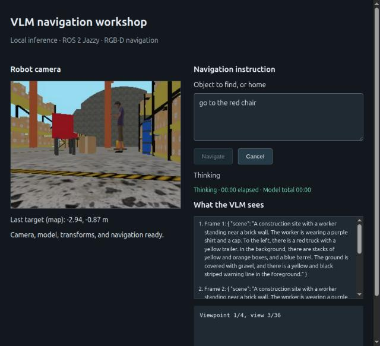
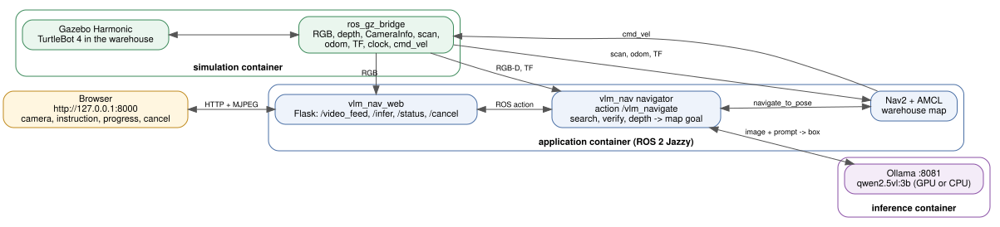

# ROS 2 VLM navigation workshop — CPU or NVIDIA GPU

A local browser sends an instruction to a ROS 2 Jazzy action server. The robot
searches camera views with Qwen2.5-VL 3B (served by Ollama), registered depth and TF locate the detected
object on the map, and Nav2 navigates toward it.

Default target: Ubuntu 24.04 on AMD/Intel x86-64 with AVX2, CPU-only, 8 GB RAM.
Optional NVIDIA GPU inference is selected with a launch argument.
See [architecture](docs/architecture.md) for interfaces and acceptance criteria.
The default simulation uses the official TurtleBot 4 Standard robot and
warehouse environment. The original small-room demo remains selectable. See
[validation](docs/validation.md) for measured RAM, latency, and test boundaries.





## Prerequisites

- Linux Docker Engine and Docker Compose; permission to run Docker.
- An x86-64 CPU with AVX2 (modern AMD Ryzen processors qualify).
- Approximately 30 GB free SSD space for image builds, caches, and model files.
- Internet for the first build, warehouse asset downloads, and the 3.2 GB VLM download.
  Runtime uses baked warehouse resources and the locally stored model.
- Ports 8000 and 8081 available. These bind to localhost by default.

Install Docker, Compose v2 and the NVIDIA Container Toolkit with
[`scripts/install_prereqs.sh`](../scripts/install_prereqs.sh) from the repo root.

Use one mode at a time: the services intentionally share localhost ports.
Choose a distinct ROS domain if other ROS applications run on the host.
The defaults use domain 77 and UDP DDS transport to avoid cross-container
shared-memory transport issues. Native ROS clients must use the same settings.

## Tested environment

Verified on 2026-10-25 by running this project from this README in GPU mode.
Everything except the host rows runs inside Docker, so the host needs no ROS or Gazebo.

| Component | Version |
|---|---|
| Host OS | Ubuntu 24.04.4 LTS (kernel 7.0), X11 desktop session |
| Host hardware | Intel Core i7-13650HX, 23 GB RAM, NVIDIA GeForce RTX 4060 Laptop GPU (8 GB) |
| NVIDIA | Driver 580.178.04 (CUDA 13.0), NVIDIA Container Toolkit 1.19.1 |
| Docker | Docker Engine 29.6.2, Docker Compose v5.3.1 |
| Container OS | Ubuntu 24.04.5 LTS, `ros:jazzy-ros-base` image (`vlm-workshop-ros:local`) |
| ROS 2 | Jazzy (rclpy 7.1.12), Fast DDS (`rmw_fastrtps_cpp`) over UDP, `ROS_DOMAIN_ID` 77 |
| Gazebo | Harmonic (Gazebo Sim 8.15.0), ros_gz 1.0.24 |
| Robot and navigation | TurtleBot 4 Standard description 2.1.1, Nav2 1.3.13, slam_toolbox 2.8.5, gz_ros2_control 1.2.20 |
| Python | 3.12.3, OpenCV 4.6.0, NumPy 1.26.4, Flask 3.0.2, cv_bridge 4.1.0 |
| VLM server | Ollama 0.40.10 (`ollama/ollama:0.40.10` image), model `qwen2.5vl:3b` (3.2 GB), port 8081 |
| Disk space | About 17.5 GB: ROS image `vlm-workshop-ros:local` 5.8 GB plus the shared Ollama image (8.4 GB) and `qwen2.5vl:3b` model volume (3.2 GB), stored once for all projects. Keep 25-30 GB free for the first build (Docker build cache, warehouse asset downloads). |

## First-time Docker setup

ROS 2, Gazebo, Nav2, and inference run in Docker; no host ROS or Gazebo
installation is needed. The helper creates `.env` if needed, builds the ROS
image, starts the official Ollama container and pulls `qwen2.5vl:3b` into the
`ollama` Docker volume, available to the application under the name `vlm`.
It uses Docker Compose v2 (`docker compose`).

```bash
cd ~/vlm_packt_workshop/turtlebot4_vla_object_finder

# Choose one setup mode. Re-running setup reuses the downloaded model.
bash scripts/workshop.sh setup gpu   # NVIDIA GPU (recommended)
# Or, without an NVIDIA GPU:
bash scripts/workshop.sh setup cpu
```

The first setup needs internet access and about 30 GB of free disk space. GPU
setup requires NVIDIA drivers and Docker GPU support through
[NVIDIA Container Toolkit](https://docs.nvidia.com/datacenter/cloud-native/container-toolkit/latest/install-guide.html).
The Ollama image is prebuilt for all NVIDIA GPUs, so nothing is compiled. For
an existing small-room `.env`, set `SIM_SCENE=warehouse` and
`SIMULATION_MEMORY=1536m` to use the current warehouse defaults.

## Start the real simulation

After setup, start CPU or GPU mode with the helper. It starts the demo in the
background and checks that an inference request or robot motion is not active
before switching devices:

```bash
cd ~/vlm_packt_workshop/turtlebot4_vla_object_finder

# Start either mode
bash scripts/workshop.sh start gpu   # recommended
# Or:
bash scripts/workshop.sh start cpu

# Stop workshop containers and the optional Gazebo GUI
bash scripts/workshop.sh stop
```

Wait until the browser status is ready, idle, and stationary. You can inspect it
with `curl -fsS http://127.0.0.1:8000/status` while initialization completes.
If it reports `ready: false`, its `reasons` field identifies missing components.
A container marked healthy means its HTTP endpoint responds; application
readiness also requires camera/depth, TF, clock, localization, and Nav2.

Open **http://127.0.0.1:8000** in a browser on this PC:

1. Wait for the camera image and ready status.
2. Submit `go to the standing person` and wait for the navigation result.
3. Submit `home` and wait for it to finish. Home is the warehouse spawn pose (-3, -1).
4. Use the Cancel control to cancel an active request.

On an RTX 4060 laptop each detection takes about 0.5 s. CPU timings for the 3B model
have not been measured yet; expect tens of seconds per image. Submit one request at a time. If the object is
absent, the robot turns in 10-degree steps, waits one second after each turn,
and takes a fresh RGB-D check. It then visits up to three spaced viewpoints in the connected free
part of the existing map and repeats the checks. Nav2 plans and executes all
motion. Each fully framed detection gets a second, cropped-image identity check
before an approach is allowed. The crop is described without naming the requested
target; common class synonyms (such as man/person) and requested colors are checked
against that description. Unrecognized target classes use a short text comparison.
A rejection continues the search. A positive candidate can need two visual model
calls plus a short text comparison. Search stops when a valid target is found,
you cancel, the viewpoints are exhausted, or the 15-minute budget cannot fit
another view's inference timeouts.
This is a bounded search of a known map; it does not build a map or guarantee
that every object in the warehouse will be seen. Returning home restores the
initial viewing position.

The browser logs a target-independent **What the VLM sees** description for every
camera frame used by a request. It is for operator visibility only and does not
control a motion decision. It adds one model call per camera frame, so CPU-mode
searches take longer. The browser then shows `searching`, `searching_navigation`, `thinking`, `confirming`, and then
`navigating` when the robot approaches a detected target. A malformed model
response or invalid depth ends the request rather than producing a motion goal.
The small VLM can still misidentify objects; these checks reduce false positives.
The browser shows a live elapsed timer for thinking and confirmation, plus total
model time across search views. These are measured wait times, not a countdown.
Cancel during inference discards its result when the model request returns.

Configure search in `src/vlm_nav_bringup/config/warehouse.yaml` under
`vlm_navigator.ros__parameters`: `search_enabled` (default true),
`search_map_enabled` (true), `verify_detection` (true), `search_headings` (36, 10° spacing),
`search_rotation_delay` (1.0 second after each turn), `search_locations` (3),
`search_spacing` (3.0 metres), `search_clearance` (0.45 metres), and
`search_timeout` (900.0 seconds). Rebuild the ROS image after changing YAML.
Without a matching `/map`, it performs only the local look-around and reports
that limitation. CPU checks can make an unsuccessful search take several minutes.

The home view includes a red chair, cardboard box, standing person, and blue
barrel. A green crate, orange cone, and yellow box are spread through the mapped
warehouse for search demonstrations. The warehouse uses the official TurtleBot 4 Standard/Create3 meshes, collision
geometry, wheel dimensions, OAK-D RGB-D camera placement, RPLIDAR, and warehouse
navigation map. The upstream warehouse layout and object placements are retained.
The robot starts at (-3, -1), facing the standing person near (1, -1).
For CPU operation the OAK-D runs at 2 Hz and the lidar at 5 Hz/180 samples.
Create3 docking, battery, buttons, cliff/IR, and wheel-drop status emulation
are omitted; one Gazebo differential-drive plugin owns simulated motion. It uses Mesa software rendering inside
Xvfb: no GPU device or display forwarding is required. Gazebo's `gpu_lidar`
sensor name describes its rendering implementation; this demo executes that
rendering on the CPU. No Gazebo desktop window opens; use the browser camera.

If you changed `WEB_PORT` in `.env`, use that port in browser URLs, curl commands,
and verification commands (`--url http://127.0.0.1:YOUR_PORT`). The inference
port remains 8081. Host networking means `docker compose ps` may show no port
mappings even though the localhost endpoints are available.

To use the earlier small-room robot and red-chair/blue-table tasks instead,
set `SIM_SCENE=workshop` in `.env` and recreate the stack with `down` / `up -d`.
Use `SIM_SCENE=warehouse` (the default) for TurtleBot 4. The same scene setting
selects the simulation, map, initial localization pose, and home pose together.

GPU mode runs the same Ollama image with access to the NVIDIA GPU; the
inference API, robot, map, search logic, and CPU software rendering in Gazebo
stay the same. This option supports NVIDIA GPUs, not AMD/Intel integrated GPUs.
Switching devices recreates only inference, preserving the robot pose and
localization. If a request is active or the robot is moving, use Cancel and wait
for its terminal result before switching. The helper also stops the optional
Gazebo GUI when you run its `stop` command.

Qwen2.5-VL answers boxes in pixels of the image Ollama resizes it to, not in
normalized coordinates: small frames are scaled up to at least 1024×28×28 pixels
with sides in multiples of 28, so every 4:3 frame becomes 1036x784. The client
converts boxes from that size back to the camera image (`model_size` and
`parse_box` in `vlm_nav/perception.py`).

Inspect the selected backend:

```bash
docker compose --profile simulation logs --tail 60 inference
docker compose --profile simulation exec inference ollama ps   # PROCESSOR shows GPU or CPU
curl -fsS http://127.0.0.1:8000/status
```

Ollama falls back to the CPU without an error when the container cannot reach
the GPU; `ollama ps` shows which one is in use.

## Open the optional Gazebo 3D GUI

With the Docker simulation running, open a second terminal on the Linux
desktop:

```bash
cd ~/vlm_packt_workshop/turtlebot4_vla_object_finder
bash scripts/open_sim_gui.sh
```

The launcher starts a GUI-only container from the simulation's exact image,
so all warehouse meshes and textures are available at the same paths. It
mounts the desktop X11 socket and authorization file read-only, enables Mesa
CPU rendering with a compact 900x600 OGRE GUI view, and selects the server's
Gazebo transport partition. No host Gazebo installation is needed.

A plain `gz sim -g` under the desktop user can use a different partition from
the container's root user and wait indefinitely for world discovery.
ROS_DOMAIN_ID does not select the Gazebo transport partition.

Close the GUI or press Ctrl+C in its terminal to remove the GUI container;
the simulation server keeps running. To stop it from another terminal:

```bash
docker stop packt-vlm-workshop-gui
```

The launcher needs a local X11/XWayland desktop session with `DISPLAY` and
`XAUTHORITY` set. It does not relax X11 access using xhost. The optional GUI has
a separate 768 MiB limit and adds CPU/RAM beyond the headless demo measurements.

## Verify the running simulation

With the robot home and the standing person visible, run the complete real-model test:

```bash
cd ~/vlm_packt_workshop/turtlebot4_vla_object_finder
python3 scripts/verify_demo.py --mode simulation --prompt 'go to the standing person'
```

This moves the robot and checks the actual HTTP → VLM → ROS action → Nav2
result. Return home through the browser before another initial-view object test.

To exercise search instead of immediate detection, first submit `home` and wait
until the application is idle. Turn the robot away from the person with Nav2:

```bash
docker compose exec -T application /entrypoint.sh ros2 action send_goal \
  /navigate_to_pose nav2_msgs/action/NavigateToPose \
  '{pose: {header: {frame_id: map}, pose: {position: {x: -3.0, y: -1.0}, orientation: {z: -0.70710678, w: 0.70710678}}}}'
```

Wait for `SUCCEEDED`, then submit `go to the standing person` in the browser.
The initial camera view should contain warehouse shelves rather than the person.
Watch for `searching_navigation` between camera checks, followed by `navigating`
after detection. Detections touching the image boundary are skipped so the robot
can check an overlapping view before approaching. For streamed feedback in the terminal:

```bash
curl -N http://127.0.0.1:8000/infer \
  -H 'Content-Type: application/json' \
  -d '{"prompt":"go to the standing person"}'
```

Alternatively, after the same turn-away step, use the automated assertion:

```bash
python3 scripts/verify_demo.py --mode simulation --expect-search
```

Run only one of the browser, curl, or verifier requests; the application accepts one
request at a time. Use Cancel to stop a long search. A target that stays absent
should cause look-around and map viewpoint visits until the bounded search ends.
The mock verifier also tests this branch with `go to the missing object` and
finds a deliberately hidden fixture using `go to the hidden chair`; those are
synthetic test cases.

To check live RGB-D, advancing clock, and map/camera TF without moving:

```bash
docker compose --profile simulation exec -T application /entrypoint.sh   ros2 run vlm_nav_demo check_ros
```

Optional manual Nav2 test, which moves the robot independently of the web action:
run it only while the application is idle, then return home through the browser.

```bash
docker compose --profile simulation exec -T application /entrypoint.sh   ros2 run vlm_nav_demo check_ros --goal -2.5 -1.0
```

`docker compose exec` does not run the image entrypoint automatically. Include
`/entrypoint.sh` as above so ROS and workspace environment variables are sourced.
For an interactive ROS shell:

```bash
docker compose --profile simulation exec application /entrypoint.sh bash
# Inside the container:
ros2 topic list
# Exit the container shell:
exit
```

## Logs, shutdown, and rebuilding

```bash
cd ~/vlm_packt_workshop/turtlebot4_vla_object_finder

# Recent logs from the three real-demo services.
docker compose --profile simulation logs --tail 100 inference simulation application

# Follow logs live; Ctrl+C exits log viewing and leaves the containers running.
docker compose --profile simulation logs -f --tail 50 application inference

# Stop the demo and optional Gazebo GUI. Models and built images remain.
bash scripts/workshop.sh stop

# Start again later without rebuilding or downloading.
bash scripts/workshop.sh start cpu
```

After changing ROS code, packaged web assets, launch files, or world/config files,
stop the demo, rerun setup for the selected device, then start it again. For example:

```bash
bash scripts/workshop.sh stop
bash scripts/workshop.sh setup cpu
bash scripts/workshop.sh start cpu
```

Use `gpu` in the setup and start commands for NVIDIA inference. A restart alone
does not install source changes because the images contain copied files.

If startup fails, inspect `ps`, `/status`, and the logs above. A missing model
(`ollama show vlm` fails) requires the setup step; port conflicts usually mean another workshop mode
or application is still running. To reset the simulated robot/world and Nav2
localization, use the helper's `stop` followed by `start` while no request is active.

## Run the mock integration demo

Mock mode needs only the ROS image, with no model download or Gazebo:

```bash
cd ~/vlm_packt_workshop/turtlebot4_vla_object_finder
if [ ! -f .env ]; then cp .env.example .env; fi

# Release the ports used by any other workshop mode.
docker compose --profile mock --profile simulation --profile external down

docker compose --profile mock build mock
docker compose --profile mock up -d mock
docker compose --profile mock ps
python3 scripts/verify_demo.py --mode mock

# Stop mock mode before starting simulation or external mode.
docker compose --profile mock down
```

While mock mode runs, open **http://127.0.0.1:8000** and try
`go to the red chair`, `home`, or `go to the missing object`.
Mock mode supplies synthetic RGB-D images, deterministic detections, and a
mock Nav2 action server. It verifies ROS/web wiring, not Gazebo motion or model
accuracy. The verification also exercises concurrent-request rejection and
confirmed cancellation.

## Memory configuration and measurement

The warehouse limits are 3 GiB inference, 1.5 GiB simulation, and 768 MiB
application/Nav2 (5.25 GiB combined). The full warehouse exceeded the earlier
small-room 1 GiB simulation limit at startup; 1.5 GiB is a revised allocation.
Limits are not measurements, and an OOM kill is a failed run.
No swap allowance is given to these three containers. The host needs additional
RAM for the OS, Docker, browser, and other programs. Docker image size is disk
usage, not runtime RAM usage.

Inference uses one model/slot, a 2,048-token context, one low-resolution image,
1,024 visual tokens, and up to 128 generated tokens. `.env` exposes CPU threads
and container memory limits. Four inference threads are the default; leave CPU
capacity for sensor rendering and Nav2.

Record usage while submitting several instructions, including a cancellation:

```bash
python3 scripts/measure_resources.py --seconds 180 \
  --containers $(docker compose --profile simulation ps -q) \
  --output artifacts/resources.jsonl
```

The JSONL file includes host memory/swap snapshots, container stats, and cgroup
peak memory. On a development PC with unrelated workloads, host usage includes
those workloads; it does not establish an 8 GB PC result. Verify on the target
PC with the OS and browser present. Do not increase limits and then claim the
original low-memory target passed.

## Existing robot or simulator

The `external` profile runs application and inference against an existing ROS
stack instead of launching this world:

Complete the first-time Docker setup above, then run:

```bash
cd ~/vlm_packt_workshop/turtlebot4_vla_object_finder
docker compose --profile mock --profile simulation --profile external down
docker compose --profile external up -d
docker compose --profile external ps
curl -fsS http://127.0.0.1:8000/status

# When finished:
docker compose --profile external down
```

It expects registered RGB-D topics, CameraInfo, odometry, map-to-camera TF,
and active Nav2 lifecycle nodes as listed in the architecture. It defaults to
wall-clock time. Custom topics, frames, lifecycle names, and stand-off distance
are ROS parameters in `src/vlm_nav_bringup/config/low_memory.yaml`; rebuild the
ROS image after changing packaged configuration. WEB_PORT applies to all modes.

The robot must be stationary at capture time. Requests fail explicitly for
unready sensors/TF/Nav2, malformed detections, invalid depth, robot displacement
during inference, navigation errors, or timeouts. Cancellation during inference
holds the request until the synchronous inference call finishes or times out,
then discards its result. During motion, the UI reports cancellation after Nav2
confirms the terminal action state.

## Local build and tests

Docker is the supported reproducible path. For a native Jazzy development
installation, install dependencies using rosdep and the Python packages from
the Dockerfile, then:

```bash
source /opt/ros/jazzy/setup.bash
colcon build --executor sequential --cmake-args \
  -DCMAKE_BUILD_TYPE=Release -DPython3_EXECUTABLE=/usr/bin/python3
source install/setup.bash
PYTHONPATH=src/vlm_nav /usr/bin/python3 -m pytest -q tests
```

Native warehouse launch also requires the official TurtleBot 4 simulator
packages and generated local assets. Docker generates these automatically.
For native setup, after installing `ros-jazzy-turtlebot4-simulator` and sourcing
Jazzy, run `python3 scripts/prepare_tb4_assets.py "$PWD/src/vlm_nav_sim"` before
building. This downloads the pinned warehouse resources. The small workshop
can be launched with `scene:=workshop` without generating warehouse assets.

Run tests inside the image:

```bash
docker run --rm vlm-workshop-ros:local \
  python3 -m pytest -q /ws/tests
```

## Provenance

Workflow and action interface adapted from
[metanav/VLM_ROS_2_Dragonwing_IQ-9075](https://github.com/metanav/VLM_ROS_2_Dragonwing_IQ-9075),
Apache-2.0. See LICENSE and NOTICE.

Robot and warehouse assets come from the official
[TurtleBot 4 Jazzy simulator](https://github.com/turtlebot/turtlebot4_simulator/tree/jazzy),
[TurtleBot 4 description/navigation](https://github.com/turtlebot/turtlebot4/tree/jazzy),
and [iRobot Create3](https://github.com/iRobotEducation/create3_sim/tree/jazzy)
packages. Warehouse Fuel versions and source-SDF checksums are pinned in
`scripts/warehouse_assets.lock.json`; original asset metadata is retained in
the image. Runtime does not fetch these resources.

Qualcomm GenieX and QAIRT are replaced with
local CPU inference. The ROS nodes, web UI, CPU adaptation scripts, small-room assets, and
deployment files are newly authored. TurtleBot 4 and warehouse assets come
from the packages and model publishers listed above.
