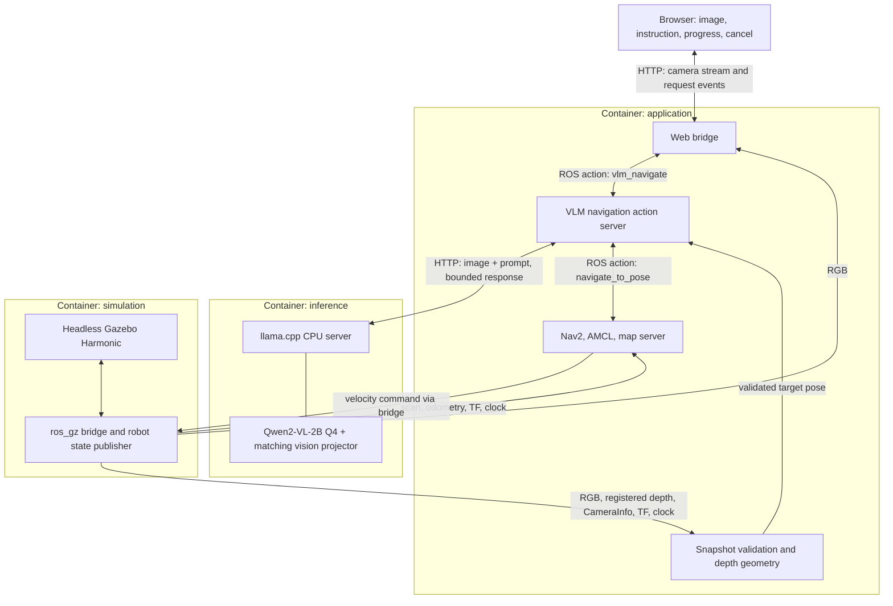

# CPU-only VLM navigation demo architecture

Status: implemented. Real CPU inference, Gazebo navigation, and cancellation
passed on an x86-64 development host. See [validation](validation.md) for evidence
and the remaining physical 8 GB AMD PC acceptance check.

Target: AMD x86-64 Linux PC with 8 GB physical RAM, Ubuntu 24.04 containers,
ROS 2 Jazzy, local CPU inference, and a TurtleBot 4 warehouse simulation.
The RAM requirement applies to the whole PC, including the OS and browser.

## Application behavior

The user watches a simulated robot's RGB camera in a browser and submits an
instruction such as “go to the chair.” The application captures aligned RGB,
depth, calibration, and timestamped transforms; asks the VLM for a bounding
box; estimates the object's map position; and asks Nav2 to approach it.
The browser shows the detection, proposed goal, progress, result, and cancel
control. Nav2 owns motion planning and velocity commands.

The reference repository contains the VLM application, but no simulation
world, robot model, or Nav2 bringup. This implementation adds those components using the official Jazzy TurtleBot 4
Standard robot description and warehouse assets. The previous small workshop
world remains optional via SIM_SCENE=workshop.

## Runtime layout



All ROS processes share one configured ROS_DOMAIN_ID and DDS configuration.
The initial deployment uses Linux host networking to simplify cross-container
ROS discovery. Inference binds to loopback; the web UI defaults to loopback.
Ports are configurable. Model files are mounted read-only from persistent storage.

## ROS package responsibilities

- `vlm_nav_msgs` (ament_cmake): VlmNavigate action and a GetReadiness service.
  Keep upstream action fields where practical; document changed semantics.
- `vlm_nav` (ament_python): action server, CPU inference HTTP adapter,
  synchronized snapshot capture, box parsing, depth projection, goal preview,
  Nav2 client, cancellation, and readiness diagnostics.
- `vlm_nav_web` (ament_python): installed browser assets, MJPEG stream, HTTP
  request validation, NDJSON feedback, status, and cancellation endpoints.
- `vlm_nav_sim` (ament_cmake): small SDF world, differential-drive robot with
  RGB-D camera and lidar, bridge configuration, map, and simulation launch.
- `vlm_nav_bringup` (ament_python): complete launch composition, Nav2 parameters,
  model/client configuration, use_sim_time, and the low-memory preset.
- `vlm_nav_demo` (ament_python): deterministic sensor fixtures, mock inference
  and Nav2 endpoints for integration tests. These are separate from the real
  Gazebo + VLM + Nav2 demonstration.

## Interfaces and coordinate conventions

ROS inputs:

- `/camera/color/image_raw`: sensor_msgs/Image, RGB/BGR image.
- `/camera/aligned_depth/image_raw`: sensor_msgs/Image, depth registered to RGB;
  support 32FC1 metres and 16UC1 millimetres explicitly.
- `/camera/color/camera_info`: sensor_msgs/CameraInfo for the RGB image geometry.
- `/scan`, `/odom`, `/tf`, `/tf_static`, and `/clock`: navigation and timing.

The simulator/bridge must deliver genuinely aligned RGB and depth. Renaming
a raw depth topic does not perform registration. The initial world uses a
co-located RGB-D sensor and validates matching dimensions and intrinsics.

TF ownership: AMCL publishes map → odom; simulation odometry publishes
odom → base_footprint; robot_state_publisher publishes base_footprint →
base_link → camera frames.
Use an optical camera frame with the standard camera-axis convention.
Do not also publish a competing map → odom transform.

Application interfaces:

- `/vlm_navigate`: instruction goal; thinking, validating, navigating, and
  terminal feedback; success/error result and raw VLM response.
- `/vlm_nav/readiness`: model, camera, depth, calibration, TF, clock, and Nav2
  readiness, plus explicit reasons for unavailable components.
- `/vlm_nav/target_pose`: geometry_msgs/PoseStamped for inspection.
- `/navigate_to_pose`: existing Nav2 action; retain its real goal handle.
- Velocity output: configure the bridge to match Jazzy Nav2's selected Twist
  or TwistStamped output. Validate message types before enabling navigation.

HTTP routes: GET `/`, `/status`, `/video_feed`; POST `/infer`, `/cancel`.
The web bridge uses the readiness service rather than treating discovery of
the action server as proof that the entire application is ready.

VLM contract: image + explicit object instruction → one bounding box or a
not-found result. The adapter normalizes model coordinates into the original
RGB pixel coordinates, accounting for resizing and letterboxing. Validate
finite values, bounds, ordering, and nonzero area. JSON validity does not prove
that the box identifies the requested object.

## Request lifecycle

1. Reject empty instructions or requests while another goal is active.
2. Confirm model, clock, sensors, calibration, localization, and Nav2 readiness.
3. Ensure the robot is stationary; capture a time-aligned RGB-D snapshot and
   the map/camera/base transforms at the snapshot timestamp.
4. Run bounded CPU inference in a worker so ROS callbacks remain responsive.
5. If the model reports `found:false`, turn to the next search heading; after
   local headings, visit a connected map viewpoint. Repeat from step 3 within
   the search budget. Otherwise validate the box and its coordinate convention, require full framing,
   and confirm identity using a cropped-image VLM call. Select a substantial connected foreground depth surface
   within the box, since its centre may fall between chair or table legs; reject missing, inconsistent, or implausible depth.
6. Back-project using camera intrinsics, then transform using the captured TF.
   Place an approach goal on the map plane, with a configurable stand-off
   distance from the object and orientation facing it.
7. Recheck robot displacement and localization after inference. If the scene
   or robot moved beyond configured limits, reject and request a fresh capture.
8. Submit the validated pose to Nav2. Forward distance remaining and terminal
   action status to the browser. Nav2 plans around obstacles.
9. Cancel using the actual Nav2 goal handle and report the confirmed outcome.
   During inference, cancel the application request and discard its response;
   do not imply that the server computation necessarily stopped.

Use ROS simulated time for sensor/TF geometry and wall-clock time for HTTP
deadlines and process health. Bound sensor queues, feedback queues, HTTP payloads,
and pending requests. Keep model inference single-flight even after cancellation.

## Inference choice and low-memory preset

Initial model: `ggml-org/Qwen2-VL-2B-Instruct-GGUF`, Q4_K_M language weights and
matching FP16 projector. Files are approximately 986 MB + 1.33 GB; this is
download size, not a runtime RAM measurement.

Build a pinned llama.cpp revision with CPU support and no accelerator backend.
Disable GPU layer and vision-projector offload explicitly. Run one model and
one inference slot; start at a 2,048-token context and 128 output tokens.
Use one small image per request, initially around 320 × 240, and cap visual
tokens at 1,024: the runtime warns that Qwen grounding requires this minimum. Derive thread count from CPU capacity while leaving cores for simulation
and ROS. Do not retain conversational history between navigation instructions.

Real Qwen localization and navigation passed for the standing person in the
warehouse. Earlier red-chair and blue-table tasks passed in the small room. This is a small demonstration, not a general object-localization
accuracy benchmark; unseen objects and scenes need their own validation.

## Simulation design

Gazebo Harmonic is the documented pairing for ROS 2 Jazzy. Start with one small
room, a few recognizable low-poly objects, a fixed map, one mobile robot,
one RGB-D camera, and one lidar. The default now uses the full official
TurtleBot 4 warehouse layout and map rather than the earlier small room.
RGB-D rate: 2 Hz; scan rate: 5 Hz with 180 rays. The Standard/Create3 robot
geometry and calibrated OAK-D frames are retained. Navigation uses one Gazebo
differential-drive owner; hardware status and docking emulation are omitted.
Avoid high-resolution textures and extra cameras. Run without Gazebo GUI or
RViz by default and provide the camera view in the browser.

CPU-only camera rendering still needs a rendering backend. Validate headless
software rendering inside the container without accelerator device access.
Actual renderer memory and CPU cost are an acceptance gate.

Use AMCL on the provided map and an explicit initial pose, with a small Nav2
costmap and conservative speeds. AMCL uses base_footprint; the depth transform
uses the calibrated optical frame. Nav2 servers run as separate processes so
nested costmap configuration reaches each node. Regulated Pure Pursuit performs
rotate-to-heading and approaches at 0.2 m/s, with a 1.0 m object stand-off.
The TurtleBot 4 keeps its official wheel/caster geometry and bounded drive
acceleration. The original workshop robot has front and rear caster supports. SLAM is outside the initial demo scope.
The standing person is visible from the warehouse spawn/home pose (-3, -1). Requests now scan the current location, then up to three connected, clearance-safe
map viewpoints. Each location has eight stop-and-look headings. Unknown map cells
and narrow passages excluded by the clearance mask are not searched. Nav2 remains
the sole motion owner and may reject a viewpoint using its live costmaps.
A new stationary RGB-D frame is required after every movement. A valid
`found:false` response or an image-boundary-clipped detection advances the search;
malformed boxes and invalid depth abort. A fully framed candidate also requires a
second VLM call describing its crop without disclosing the target. Common class
synonyms, explicit colors, and standing/seated contradictions are compared in code.
Other object classes use a text-only comparison with a 15-second deadline.
Rejected identity advances the search. Calls use the same single model slot,
preserving the memory cap.
These checks reduce false positives but do not prove semantic accuracy.
Search is bounded to 900 seconds, reserves both visual inference timeouts and the optional text-comparison timeout before each
new view, and remains cancellable. It is not exhaustive coverage or SLAM.

## RAM budget and verification

Design allocations, not measured requirements:

- CPU inference: 3.0 GiB.
- Gazebo, rendering, bridge, robot state publisher: 1.5 GiB (warehouse).
- Nav2, application nodes, web bridge: 0.75 GiB.
- OS, Docker overhead, and one browser tab: 1.75 GiB.

Target total: 7.0 GiB, with headroom on an 8 GB machine. A machine marketed as
8 GB may expose less usable RAM, especially with integrated graphics; use
the actual available physical memory when evaluating the target.

Container limits enforce a ceiling but do not demonstrate that the demo fits.
An OOM kill, significant sustained swapping, or unusable simulation performance
is a failed run. Model-file mmap/page cache and tmpfs/shared memory count toward
the budget. Avoid double-counting shared pages when measuring the host total.

Record host-wide memory, per-container cgroup peak usage, swap activity,
inference latency, and simulation real-time factor during model loading,
first inference, repeated requests, navigation, cancellation, and restarts.
Acceptance requires successful real VLM + Gazebo + Nav2 execution under the
physical memory budget, without relying on swap to fit the working set.

## Deployment artifacts

```text
src/
  vlm_nav_msgs/
  vlm_nav/
  vlm_nav_web/
  vlm_nav_sim/
  vlm_nav_bringup/
  vlm_nav_demo/
docker/
  ros.Dockerfile
  inference.Dockerfile
  entrypoint.sh
compose.yaml
.env.example
scripts/
  download_model.sh
  verify_demo.py
  measure_resources.py
docs/architecture.md
README.md
```

Compose modes:

- `mock`: deterministic wiring/action lifecycle checks.
- `simulation`: real model, headless Gazebo, AMCL, and Nav2.
- `external`: application and inference connected to an existing compatible
  RGB-D + TF + Nav2 stack.

Build and download before running the memory acceptance check. Limit build
parallelism for 8 GB hosts. After downloading model assets and images, the
runtime should operate offline.

## Implementation and acceptance sequence

1. Validate CPU inference, coordinates, and memory on representative rendered
   images before committing to the perception model.
2. Prove the software-rendered RGB-D camera, advancing clock, sensor alignment,
   TF chain, and host memory usage in Gazebo.
3. Build the ROS interfaces and snapshot/geometry pipeline; test projection
   against known simulated object positions.
4. Prove Nav2 reaches a manual goal and cancellation works in the same world.
5. Integrate web requests, real VLM localization, geometry, and Nav2.
6. Run multiple object goals and failure cases under the complete RAM budget.

Success: the user requests a visible object; the real VLM locates it; depth and
TF produce a valid approach pose; Nav2 moves the simulated robot near it;
the UI reports the actual result; cancellation works; total RAM stays within
the target. Mock-action success alone does not meet this criterion.

## Sources

- Reference application: https://github.com/metanav/VLM_ROS_2_Dragonwing_IQ-9075
- Qwen GGUF assets: https://huggingface.co/ggml-org/Qwen2-VL-2B-Instruct-GGUF/tree/main
- CPU multimodal server: https://github.com/ggml-org/llama.cpp/blob/master/docs/multimodal.md
- Jazzy/Gazebo pairing: https://gazebosim.org/docs/harmonic/ros_installation/


## Optional NVIDIA inference backend

The default inference image is compiled with CUDA/Vulkan disabled. The optional
CUDA 12.8.1 image uses the same pinned source revision and model assets. A shared
entrypoint selects zero GPU layers plus disabled projector offload for CPU, or
configured GPU layers plus projector offload for CUDA. GPU mode requires a CUDA
device and rejects silent CPU fallback. Compose grants GPU devices only through
`compose.gpu.yaml`; the base file remains usable without NVIDIA tooling.

`scripts/run_demo.sh --device cpu|gpu` resolves the corresponding image/Compose
configuration, builds a missing image, checks for an idle stationary application,
and replaces inference while preserving running ROS/simulation containers. A
GPU switch does not accelerate Gazebo rendering or alter navigation ownership.
One model slot and the existing RAM caps remain; VRAM must be measured separately.
