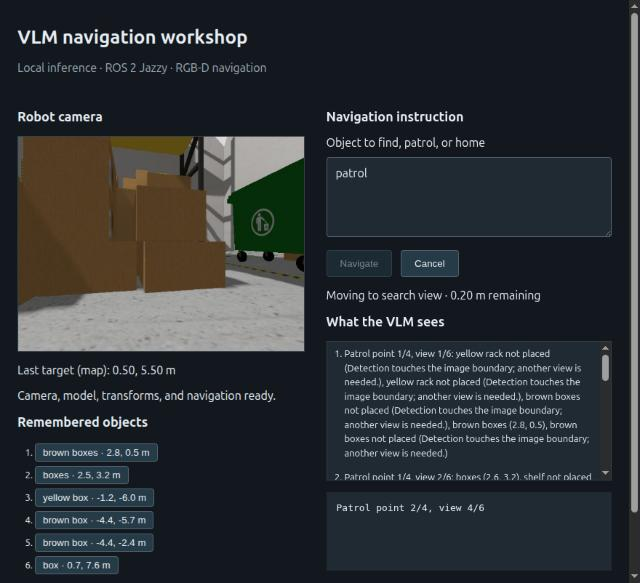
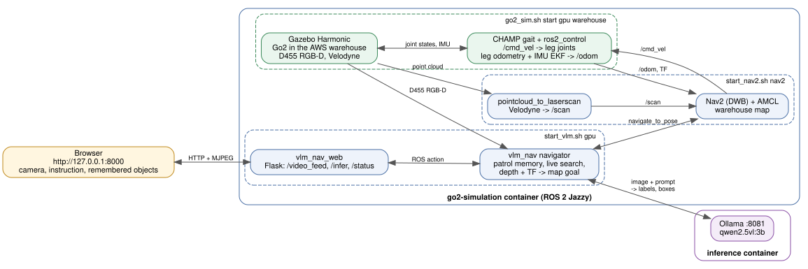

# Unitree Go2 Gazebo simulation

This project packages the [Unitree Go2 ROS 2 repository](https://github.com/khaledgabr77/unitree_go2_ros2)
with Docker setup and run/stop commands for ROS 2 Jazzy and Gazebo Harmonic.
The Go2-specific packages are in `src/`; the CHAMP packages are retained under
`upstream/unitree_go2_ros2/`.
The upstream launch starts Gazebo, spawns the Go2, starts the CHAMP gait and
state-estimation nodes, and bridges the simulated sensors. On top of that it adds
warehouse Nav2/SLAM and VLM object finding: the Go2 patrols the warehouse,
remembers the objects Qwen2.5-VL-3B sees as map waypoints, and walks to one on
request.





**Quick start (NVIDIA GPU)** — run each command in its own terminal, from this folder:

```bash
GO2_PUBLISH_MAP_TO_ODOM=false bash scripts/go2_sim.sh start gpu warehouse
bash scripts/start_nav2.sh nav2          # after the Go2 stands
bash scripts/start_vlm.sh gpu            # Ollama VLM on 8081, web UI on 8000
```

Open <http://127.0.0.1:8000>, wait for ready, send `patrol`, then
`go to the green dumpster` and `go home`. `bash scripts/go2_sim.sh stop` stops
everything. Details: [VLM object finding](#vlm-object-finding) and
[Patrol and object waypoints](#patrol-and-object-waypoints); CPU mode is below.

## Requirements

- Ubuntu 24.04, Docker Engine, and Docker Compose v2.
- An active X11 desktop session for the Gazebo window (`DISPLAY` and a readable
  `XAUTHORITY` file).
- Internet access and about 25 GB free disk for the first Docker image build and the model
  (see [Tested environment](#tested-environment)).
- For GPU mode: a compatible NVIDIA driver and working Docker GPU support via
  NVIDIA Container Toolkit.

Install Docker, Compose v2 and the NVIDIA Container Toolkit with
[`scripts/install_prereqs.sh`](../scripts/install_prereqs.sh) from the repo root.

ROS, Gazebo, CHAMP, and simulation dependencies are installed inside the image;
the host does not need a ROS installation. The upstream checkout is pinned in
[UPSTREAM.md](UPSTREAM.md).

## Tested environment

Verified on 2026-10-25 by running this project from this README in GPU mode.
Everything except the host rows runs inside Docker, so the host needs no ROS or Gazebo.

| Component | Version |
|---|---|
| Host OS | Ubuntu 24.04.4 LTS (kernel 7.0), X11 desktop session |
| Host hardware | Intel Core i7-13650HX, 23 GB RAM, NVIDIA GeForce RTX 4060 Laptop GPU (8 GB) |
| NVIDIA | Driver 580.178.04 (CUDA 13.0), NVIDIA Container Toolkit 1.19.1 |
| Docker | Docker Engine 29.6.2, Docker Compose v5.3.1 |
| Container OS | Ubuntu 24.04.4 LTS, `osrf/ros:jazzy-desktop` image (`unitree-go2-sim:jazzy`) |
| ROS 2 | Jazzy (rclpy 7.1.11), Fast DDS (`rmw_fastrtps_cpp`), `ROS_DOMAIN_ID` 89 |
| Gazebo | Harmonic (Gazebo Sim 8.15.0), ros_gz 1.0.24 |
| Robot and navigation | Go2 with the CHAMP gait (upstream commit in [UPSTREAM.md](UPSTREAM.md)), ros2_control 4.48.1, gz_ros2_control 1.2.20, robot_localization 3.8.3, Nav2 1.3.13, slam_toolbox 2.8.5 |
| Python | 3.12.3, OpenCV 4.6.0, NumPy 1.26.4, Flask 3.0.2, cv_bridge 4.1.0 |
| VLM server | Ollama 0.40.10 (`ollama/ollama:0.40.10` image), model `qwen2.5vl:3b` (3.2 GB), port 8081 |
| Disk space | About 19 GB: image `unitree-go2-sim:jazzy` 7.2 GB plus the shared Ollama image (8.4 GB) and `qwen2.5vl:3b` model volume (3.2 GB), stored once for all projects; this folder 47 MB. Keep about 25 GB free for the first build. |

## Build and run

Run from this folder. The first build installs ROS dependencies and compiles the
upstream workspace; it can take a while. Build once, then start either mode:

```bash
# Build the shared ROS/Gazebo image
bash scripts/go2_sim.sh build cpu

# Start with CPU rendering (lighter sensor configuration)
bash scripts/go2_sim.sh start cpu

# Or start with NVIDIA GPU rendering and all configured sensors
bash scripts/go2_sim.sh start gpu

# Start in the downloaded electrical substation world
bash scripts/go2_sim.sh start cpu industrial

# Start in the AWS RoboMaker warehouse world
bash scripts/go2_sim.sh start cpu warehouse

# Follow simulator output
bash scripts/go2_sim.sh logs

# Keyboard teleoperation (run in its own terminal; press Ctrl+C to exit)
bash scripts/go2_control.sh keyboard

# Or open the rqt steering GUI
bash scripts/go2_control.sh rqt

# Open RViz2 with the Go2 model and RGB camera image
bash scripts/go2_sim.sh rviz

# Stop and remove the simulation container
bash scripts/go2_control.sh stop
```

Both teleoperation options send `geometry_msgs/Twist` commands on `/cmd_vel`.
Keyboard control uses the standard `u/i/o`, `j/k/l`, `m/,/.` key layout; `q/z`
adjust linear speed and `w/x` adjust angular speed. The stop command removes the
simulation container. Build or rebuild the image with
`bash scripts/go2_sim.sh build cpu` after changing the Dockerfile so the
teleoperation tools are installed. Keyboard
teleoperation needs an interactive terminal; rqt needs the same active X11
desktop used for Gazebo.

The CHAMP forward command limit and rqt slider are set to 0.6 m/s, and Nav2
drives at up to 0.5 m/s. In a sim-time sweep the gait tracked commands up to
0.7 m/s, but body tilt rises above 0.6 m/s. Unitree's Go2 EDU speed rating is a
hardware specification, not a validated target for this fixed-cadence CHAMP
simulation gait. Gazebo runs at roughly 0.55x real time on a laptop-class CPU,
so on-screen motion looks about half as fast as the sim-time speed.

The legs use position commands (`command_interface:=position`, matching
`config/ros_control/ros_control.yaml`). Walking straight at a 0.5 m/s command in
the warehouse, body roll/pitch rate RMS was about 12/15 deg/s with position
commands versus 48-55/39-44 deg/s with the original effort PID (p 100, d 1), and
roll stayed within about ±0.7° instead of ±2.8°. The trade-off: the robot reaches
only about 0.3 m/s for a 0.5 m/s command. Launch with `command_interface:=effort`
and set `command_interfaces` back to `effort` in that file to compare.

With this gait the leg odometry under-reported forward distance: Gazebo ground
truth ran 1.11x `/odom` at `odom_scaler: 1.05`, so `config/gait/gait.yaml` uses
1.16 (0.98-1.06x on a 9-goal route through both halves of the warehouse; turning
was already accurate). On that route AMCL stayed within 0.51 m of ground truth.
Nav2 used to stall 0.20-0.25 m from goals: DWB's RotateToGoal critic defaults to
a 0.25 m tolerance and only allows rotation inside it, while the goal checker
needs 0.20 m, so the robot turned in place until the progress checker aborted.
`FollowPath.xy_goal_tolerance: 0.20` in `nav2_params.yaml` makes them agree.

`start` also builds the image if it is missing or needs rebuilding. CPU mode uses
Mesa software rendering and disables the D455 depth camera and two 3D lidars to
reduce load; it keeps the robot and RGB camera in Gazebo. GPU mode requires
NVIDIA container GPU access and enables those sensors. Gazebo physics and the
CHAMP robot controller run on the CPU in both modes; GPU mode accelerates
rendering and GPU-based sensors.

To start the container without launching Gazebo, then launch the simulator
separately, use these commands in order:

```bash
bash scripts/go2_container.sh start cpu   # or: start gpu
bash scripts/go2_container.sh gazebo
bash scripts/go2_container.sh status
bash scripts/go2_container.sh stop
```

Choose `industrial` when starting the idle container to use the downloaded
substation scene:

```bash
bash scripts/go2_container.sh start cpu industrial
bash scripts/go2_container.sh gazebo
```

The industrial scene is the [Robotnik Automation electrical substation
world](https://github.com/RobotnikAutomation/robotnik_gazebo_worlds), adapted
for this workspace's Gazebo Harmonic physics and packaged with its local models.
The original simple scene remains available as `default` and is still the
default when no world is specified. Source and licensing details are in
[`src/electrical_substation_world/README.md`](src/electrical_substation_world/README.md).

Choose `warehouse` with either launcher to run the AWS RoboMaker Small
Warehouse scene. It includes warehouse racks, pallets, clutter, and a wide
open aisle layout; its locally packaged models do not need Fuel downloads.
The scene is adapted for Gazebo Harmonic and includes a warehouse overview
camera. Source, attribution, and license details are in
[`src/go2_warehouse_world/README.md`](src/go2_warehouse_world/README.md).
The warehouse launch places the robot at `z=0.40 m` to give its legs a small
amount of extra clearance at spawn; the default and industrial worlds keep
`z=0.375 m`.

The `gazebo` command stays attached to the launch output; press Ctrl+C to end
the Gazebo launch while leaving the container up. Use `stop` to remove the
container.

The launcher uses the host X11 authorization file read-only. It does not open
global X server access with `xhost`. If your desktop uses a non-default auth
file, export its path before starting, for example:

```bash
export XAUTHORITY=/run/user/1000/gdm/Xauthority
bash scripts/go2_sim.sh start cpu
```

Check container state with `bash scripts/go2_sim.sh status`. Ctrl+C in the
terminal that started the script does not stop the background container; use
`bash scripts/go2_sim.sh stop` to stop it.

## Available interfaces

The upstream project includes a mono RGB camera (`/rgb_image`), optional D455
RGB/depth topics, IMU, GPS, foot-contact data, and optional 3D lidar topics.
Use `ros2 topic list` inside the container to inspect active interfaces. The
Go2 receives velocity commands through `/cmd_vel`; the upstream README shows
keyboard teleoperation with `teleop_twist_keyboard`.

The upstream RViz preset opens with the robot and TF displays. To see camera
images, add an `Image` display and select `/rgb_image`. In GPU mode, you can
also select `/d455/image` or `/d455/depth_image`, and add `PointCloud2`
displays for `/d455/points`, `/unitree_lidar/points`, or
`/velodyne_points/points`. The optional D455 and lidar sensors are disabled by
default in CPU mode, so those topics are only available in GPU mode unless
explicitly enabled.

## Warehouse Nav2 and SLAM

The warehouse scene has a generated 2D occupancy map based on the SDF collision
geometry, plus separate `go2_warehouse_nav2` and `go2_warehouse_slam` ROS 2
packages. Both convert the Go2 Velodyne point cloud to `/scan` and use `/odom`
with `base_footprint`. Nav2 uses AMCL with the generated static map; SLAM mode
builds a map online with slam_toolbox and starts Nav2 against that live map.

AMCL and slam_toolbox publish the `map -> odom` transform, so disable the
simulation's fixed transform and enable the Velodyne before starting the
warehouse world:

```bash
# GPU sensors enabled (recommended)
GO2_PUBLISH_MAP_TO_ODOM=false bash scripts/go2_sim.sh start gpu warehouse

# Or CPU rendering with Velodyne enabled
GO2_PUBLISH_MAP_TO_ODOM=false GO2_DISABLE_VELODYNE=false \
  bash scripts/go2_sim.sh start cpu warehouse
```

Start Nav2 on the generated map, or start online SLAM with Nav2:

```bash
bash scripts/start_nav2.sh nav2
bash scripts/start_nav2.sh slam
```

Press Ctrl+C in the navigation terminal to stop those nodes; if the launch was
started from a non-interactive terminal, use `bash scripts/stop_nav2.sh`.
This stops Nav2/SLAM while leaving Gazebo running. To open RViz with the Nav2 map and costmaps, run `bash scripts/start_nav2.sh nav2 true`. The map
is `src/go2_warehouse_nav2/maps/warehouse/warehouse.yaml`; regenerate it after
changing the world with:

```bash
python3 src/go2_warehouse_nav2/scripts/generate_warehouse_map.py
```

Save a map produced by online SLAM with:

```bash
docker compose -p unitree-go2-vlm-navigation exec go2-simulation \
  bash -lc 'source /go2_ws/install/setup.bash && ros2 run nav2_map_server map_saver_cli -f /go2_ws/warehouse_slam_map'
```

See [UPSTREAM.md](UPSTREAM.md) for the robot source revision and its licensing notes.

## VLM object finding

Type an instruction such as `go to the green dumpster` in a browser and the Go2
finds it from patrol memory (below) or looks for the object with Qwen2.5-VL-3B in its D455 RGB-D camera, projects the
detection into the map with depth and TF, and walks there with the Nav2 stack
above. If the object is not in view it turns in place and then visits a few
free-space viewpoints on the map; an object it cannot find is refused without
moving to a goal.

The pipeline is the TurtleBot 4 object finder from
[`../turtlebot4_vla_object_finder`](../turtlebot4_vla_object_finder/), copied
into `src/vlm_nav`, `src/vlm_nav_msgs`, and `src/vlm_nav_web`. Go2-specific
settings are in `src/vlm_nav/config/go2_warehouse.yaml`: D455 topics
(`/d455/image`, `/d455/depth_image`, `/d455/camera_info`), `map` and
`base_footprint` frames, and `camera_frame: d455_camera_depth_optical_frame`.
Gazebo stamps the D455 images with `d455_camera_link` (x forward), while the
pixels follow the optical convention (z forward), so the navigator relabels
them with the optical frame at the same origin. The model server is the official
Ollama image serving `qwen2.5vl:3b` from the `vlm-workshop-ollama` volume shared
with the other workshop projects; the first start downloads the model (3.2 GB).

Run each command in its own terminal, from this folder:

```bash
GO2_PUBLISH_MAP_TO_ODOM=false bash scripts/go2_sim.sh start gpu warehouse
bash scripts/start_nav2.sh nav2
bash scripts/start_vlm.sh gpu      # Ollama VLM server on 8081, web UI on 8000
```

Open <http://127.0.0.1:8000>, wait for the status to show ready, and send an
instruction. `go home` returns to the start pose. Ctrl+C in the `start_vlm.sh`
terminal stops the navigator; `bash scripts/start_vlm.sh stop` also stops the
model server, and `bash scripts/go2_sim.sh stop` stops everything. Ports 8000
and 8081 are shared with the other workshop projects, so stop those first.

### Patrol and object waypoints

Send `patrol` to have the Go2 walk the `patrol_points` in
`src/vlm_nav/config/go2_warehouse.yaml` with Nav2, turning through
`patrol_headings` views at each point. For every view Qwen2.5-VL lists the objects
it sees with boxes; depth and TF place each one in the map, and it is remembered
as a labelled waypoint: the object position plus a viewing pose 1.2 m in front of
it, which the robot reached on patrol. Waypoints appear under "Remembered
objects" in the web UI (click one to fill in `go to the …`) and as
`visualization_msgs/MarkerArray` on `/vlm_nav/objects` for RViz.

After a patrol, `go to the <object>` first matches the instruction against the
remembered labels and sends Nav2 straight to that waypoint's pose, with no
searching. When nothing matches (a named color must appear in the remembered
label), it falls back to the live search described above. Memory lasts until the
navigator restarts. Boxes clipped by the image edge, floor markings, and walls
are not stored.

Measured in GPU mode (RTX 4060 Laptop GPU) with `qwen2.5vl:3b`, four patrol
points with six views each, starting from a fresh launch:

| Instruction | Result | Time |
|---|---|---|
| `patrol` | 24 views, 15 objects remembered; the dumpster stored twice, as "green trash bin" at (-1.24, 7.36) from point 2 and "green dumpster" at (-1.66, 7.28) from point 3, within 0.5 m of its model origin | 380 s |
| `go to the green dumpster` | matched "green dumpster" from memory, walked to its waypoint, ended facing the dumpster | 46 s |

Earlier patrol runs with the Qwen2-VL-2B model (not repeated with the 3B model):

| Instruction | Result | Time |
|---|---|---|
| `go to the yellow metal rack` | matched "yellow metal racks", arrived 0.26 m from the stored pose | 27 s |
| `go to the pallet truck` | wrong object: "pallet" matched the remembered "pallets" stack, not the pallet jack (stored as "forklift") | 29 s |
| `go to the blue sofa` | no remembered match, live search refused it after 30 views | 536 s |

Limits seen while testing: patrol labels vary between views. Without a color in
the prompt the 3B model called the dumpster "truck" (with a box past the image
edge) or "trash can", and recall then failed because a named color must be in the
remembered label. The patrol prompt therefore asks for labels that start with the
color, and `identity_matches` treats dumpster, trash, bin and container as one
class. The model still invents labels for some box stacks ("bar code", "green
cone"), so check the remembered list before demoing an object. When a nearer object fills only an edge
of a box (a carton in front of the dumpster), depth placement falls back to the depth
at the box centre; before that, the point-3 view of the dumpster was always rejected
and one patrol stored no dumpster at all. Patrol skips boxes
clipped by the image edge: with four views per point the clipped dumpster was
stored 2.9 m away inside a wall. At temperature 0 the model can repeat one entry
until its token limit; complete entries are still read from the truncated reply.
AMCL stayed within 0.71 m of Gazebo ground truth through the patrol above.

**CPU mode** has no depth camera by default. Enable the D455 and the Velodyne
explicitly, and use CPU inference (each VLM answer then takes 45–60 s instead
of about 1 s, and software rendering of the depth camera slows Gazebo further):

```bash
GO2_PUBLISH_MAP_TO_ODOM=false GO2_DISABLE_VELODYNE=false GO2_DISABLE_D455=false \
  bash scripts/go2_sim.sh start cpu warehouse
bash scripts/start_nav2.sh nav2
bash scripts/start_vlm.sh cpu
```

The plain `/rgb_image` camera has no depth and is not used for object finding.
CPU mode was not tested end to end; the GPU results below were.

Measured in the warehouse world, GPU mode (RTX 4060 Laptop GPU), robot starting
at the origin, with Qwen2-VL-2B before the odometry and DWB fixes above (not
repeated with the 3B model; on saved frames it boxes the dumpster correctly):

| Instruction | Result | Time | Views | Robot end (Gazebo x, y) |
|---|---|---|---|---|
| `go to the green dumpster` (run 1) | arrived, dumpster in view | 128 s | 4 | (-0.44, 6.47) |
| `go to the green dumpster` (run 2) | arrived | 54 s | 4 | (0.31, 7.31) |
| `go to the blue sofa` | refused: not found in search time limit | 545 s | 30 (3 viewpoints) | no goal sent |

The dumpster model origin is at (-1.59, 7.72); the robot stops `approach_distance`
(1.2 m) short of the detected surface. Each VLM call takes about 1 s on the GPU;
most of the time is the Go2 turning and walking between views (Gazebo runs below
real time). Limits seen in testing: the 2B model's text-only identity check once
accepted `blue sofa` for a green bin, so a named color that the candidate's
label visibly lacks now rejects it before that check (`identity_matches` in
`src/vlm_nav/vlm_nav/perception.py`; this, the dumpster class words and the
color-first patrol prompt differ from the TurtleBot copy). Before the odometry
fix, one `go home` ended about 1.6 m from the true origin. When the robot starts
wedged next to a rack, the search can skip viewpoints it cannot reach and miss
the target.
